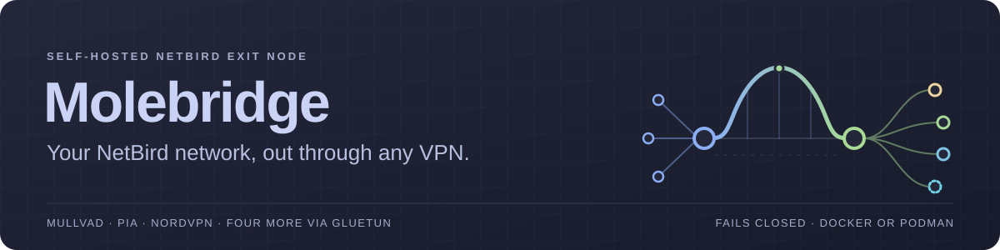
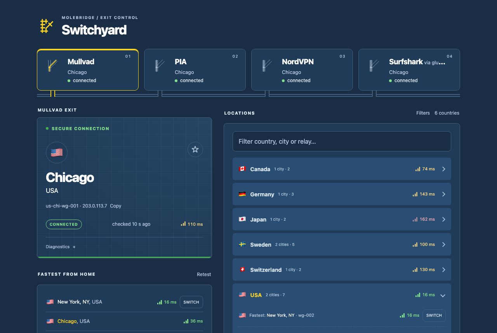
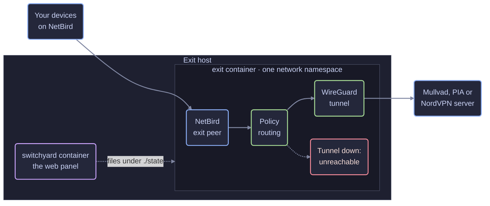

<p align="center">
  
</p>

<p align="center">
  <strong>A NetBird exit node that leaves through a commercial VPN.</strong><br>
  Self-hosted. It uses Mullvad, PIA or NordVPN directly, or gluetun for
  FastestVPN, IVPN, Mullvad, NordVPN, Surfshark and Windscribe. Routing
  fails closed, and a small web panel switches servers.
</p>

<p align="center">
  <a href="docs/setup.md"><strong>Setup</strong></a> ·
  <a href="docs/prerequisites.md">Requirements</a> ·
  <a href="docs/testing.md">Testing</a> ·
  <a href="docs/switchyard.md">The panel</a> ·
  <a href="docs/architecture.md">Architecture</a> ·
  <a href="CHANGELOG.md">Changelog</a>
</p>

---

Phones can usually run only one VPN at a time, so turning on Mullvad, PIA or
NordVPN means turning off NetBird. Molebridge moves the commercial VPN tunnel
onto a machine you keep running. That machine joins your NetBird network as an
exit node. Your devices stay on NetBird, select the exit, and their Internet
traffic leaves through the VPN provider.

By default Molebridge builds the tunnel itself (Mullvad, PIA, NordVPN).
An experimental second backend hands the tunnel to
[gluetun](https://github.com/qdm12/gluetun) instead, and Switchyard then
chooses servers for FastestVPN, IVPN, Mullvad, NordVPN, Surfshark and
Windscribe through it ([the gluetun form](docs/gluetun-netbird-exit.md)).
Either way, the devices using the exit are NetBird peers.

Separately, an experimental [gluetun sidecar](docs/gluetun-sidecar.md) lets
Switchyard choose and check the server of an ordinary gluetun container
that your other containers share, with no NetBird involved. The experimental
[native sidecar](docs/native-sidecar.md), new in 0.9.0, gives those containers a
tunnel that Molebridge builds itself, with PIA over WireGuard among the providers,
and keeps their traffic in it with its own routing contract and firewall; it has
run live once, with PIA on Kubernetes ([testing](docs/testing.md#090)).

You choose the server (Mullvad, NordVPN, the gluetun providers) or region
(PIA) in a small web panel called Switchyard. Every device using the exit
follows the switch without any client changes. Alternatively, set
[SERVER](docs/configuration.md#a-server-set-in-configuration) to keep the
exit on a configured server; the panel then shows it read-only. Connections
open through the exit drop when it switches.

<p align="center">
  
</p>

## What Molebridge is

Since 0.8.0 you pull one signed image and run it.

- **One image, one binary.** `ghcr.io/irashack/molebridge` (amd64 and arm64)
  holds one Go binary, `molebridge`, and the pinned NetBird client. The first
  argument picks the role: `exit`, `panel`, `health`, `status`,
  `check-config`, `prepare-config`, `nordvpn-key`, `gluetun-auth`,
  `gluetun-post-rules`, `gluetun-preflight`, `fix-blacklist` and `port-sync`.
  GitHub Actions builds and signs
  the image with cosign, with build provenance and SBOMs, and promotes a
  release only after a maintainer's live-acceptance run attested that the
  exact image passed ([verification of a release](docs/setup.md#1-download-and-verify)).
- **NetBird runs inside the exit container.** A native exit is two containers
  (`exit` and `switchyard`) where 0.7 had four. `molebridge exit` is PID 1 and
  supervises the worker and NetBird ([how it works](#how-it-works)).
- **Nothing to build, no Python on the host.** The setup tools run from the
  same image as throwaway containers. Only `routing/gluetun-preflight`
  remains a shell script, and it runs inside gluetun's container (the image
  carries it as the `gluetun-preflight` role).
- **Repair follows the kernel.** The exit repairs a changed routing rule,
  route, link or address when the kernel reports it, and runs a full pass
  every 30 seconds as the fallback. Live, a deleted rule was back within 0 to
  20 ms ([testing](docs/testing.md#092)).
- **A native sidecar** (0.9.0): Molebridge's own tunnel for containers that
  share the exit's namespace, for providers gluetun can't drive over
  WireGuard with Molebridge, PIA first, with `port-sync` to hand PIA's
  forwarded port to qBittorrent ([native sidecar](docs/native-sidecar.md)).

The routing contract, the status record (schema 2) and the state files keep
the names and fields they had in 0.7.0 ([state files](docs/configuration.md#state-files)).
Upgrading from 0.7 needs new
Compose files: follow [the upgrade steps](docs/operations.md#upgrading-from-07x).
What changed in each release is in the [changelog](CHANGELOG.md).

## Status: experimental

**Molebridge is experimental software with one maintainer, not a 1.0.**
[Testing](docs/testing.md) is the record, and the only place the results are
written out in full; in short:

- **Tested live at 0.9.2** ([record](docs/testing.md#092)): one Debian host
  (amd64) against a self-hosted NetBird server. On Kubernetes (k0s with
  Cilium): native Mullvad, PIA and NordVPN overlay exits, a gluetun overlay
  exit, a PIA native sidecar beside qBittorrent with a forwarded port, and a
  gluetun sidecar with NordVPN, which then moved to rootless Podman 5.8 with
  Quadlet units. Each was upgraded from 0.9.1 and came back `ok`, and the native overlay exits
  passed the rule-drift, tunnel-loss and lease-lapse drills, run from inside
  the exit's namespace with no client device held on it.
- **Run in CI:** unit, fuzz and namespace-drill suites and the release checks
  on amd64; the image checks on amd64 and arm64.
- **Not tested:** Docker Engine, podman-compose and NetBird Cloud; running the
  shipped Compose files on any engine (CI validates them with
  `docker compose config`; the live exits ran from Quadlet units and
  Kubernetes manifests this repository doesn't ship); installing from the
  signed bundle on a clean host; phones; a reboot; the panel's sign-in against
  a real identity provider; PIA port forwarding on an overlay exit; Mullvad
  and NordVPN as native sidecars; gluetun with providers other than NordVPN.
  The lists are in testing, [at 0.9.0](docs/testing.md#not-tested-at-090) and
  [at 0.8.0](docs/testing.md#not-tested-at-080).

Verify the release on your own host with the [checks](docs/verification.md)
before you rely on it, and keep a way into the host that doesn't depend on the
exit. Report vulnerabilities privately; see [SECURITY.md](SECURITY.md).

## Install

You pull a signed image and run it with Compose; the commands are in
[setup](docs/setup.md).

1. Download `molebridge-<tag>.tar.gz` and its `.sigstore.json` from the
   [latest release](https://github.com/irashack/molebridge/releases), then
   [verify the bundle, the image and its provenance](docs/setup.md#1-download-and-verify)
   before you extract or run anything.
2. Extract the bundle and copy `.env.example` to `.env`. Set `OVERLAY_CIDR`
   to your NetBird range and read the other settings: the example has
   eighteen, each commented.
3. Create the tunnel config for your provider with the image's tools, put the
   NetBird setup key in `secrets/netbird.env`, then check and start:

   ```sh
   docker compose run --rm --no-deps exit check-config
   docker compose up -d
   ```

The bundle pins the image by tag and digest (`ghcr.io/irashack/molebridge:v0.9.3@sha256:...`),
so the image that runs is the one you verified. A release tag never moves;
`:0.8` follows the newest 0.8 patch release. To build from source instead,
see [CONTRIBUTING](CONTRIBUTING.md#building-the-image).

## How it works



A native exit is two containers from one image. The `exit` container owns the
network namespace. Its first process is a supervisor; it starts a worker that
checks the tunnel config, installs the routing rules before the tunnel
exists, brings the tunnel up, runs the provider logic and keeps all of it in
place, and the supervisor starts the pinned NetBird client once the worker
reports ready. The `switchyard` container is the panel, with no capabilities
and no network in common with the exit. With the gluetun backend, gluetun owns the namespace
and the tunnel, and the `exit` container joins it and keeps the same routing
rules in place ([architecture](docs/architecture.md#gluetun-backend)).

Traffic forwarded from your devices can only go into the tunnel. If the
tunnel or its routes disappear, that traffic is dropped, not sent over the
host's own connection. The exit's own NetBird and VPN control traffic uses the
host's normal route. If the worker stops responding, the supervisor stops
NetBird, removes the interfaces it owns, leaves the routing rules in place
and exits, and the engine's restart policy starts the container again.

The panel holds no VPN credentials, no gluetun control-server key and no
capabilities, and runs no commands. With OpenID Connect sign-in it can hold
that sign-in's client secret. It writes one file naming the server you
picked. The exit checks that name against the provider's server list, which
it downloads itself (or reads from gluetun), then changes the tunnel and
reports back.

The panel shows an exit as connected only after the exit has checked the
live peer and the address your traffic leaves from. How far that check goes
depends on the provider, and the panel says which one an exit got:

- **provider-confirmed:** the provider itself says the address is theirs.
  Mullvad, PIA and NordVPN, and Mullvad and NordVPN through gluetun.
- **tunnel checks only:** a fresh handshake with the selected server, and the
  address seen through the tunnel differs from the host's own and matches the
  provider's server list where that list gives exit addresses. No provider
  confirms it. FastestVPN, IVPN, Surfshark and Windscribe through gluetun.

Details: [architecture](docs/architecture.md).

## What you need

- **An always-on Linux host**, amd64 or arm64, with kernel WireGuard (Linux
  5.6 or later) and Docker Engine with Compose 2.24 or later, or rootless
  Podman. Windows hosts are not supported. Which of these ran at 0.8.0 is in
  [requirements](docs/prerequisites.md#host); only rootless Podman with
  Quadlet units did.
- **Resources:** measured on that host with no client traffic, a native
  Mullvad or PIA exit (NetBird included) idled at 0.3 to 0.5 % of one core
  and 67 to 78 MB; a NordVPN exit used 189 MB and a gluetun exit 123 MB,
  because they hold a large server list. The image is 61 MB unpacked
  ([testing](docs/testing.md#resources-at-080-on-rootless-podman)). Every
  byte your devices send crosses the host twice, so the host's upload speed
  caps throughput.
- **A NetBird network**, either NetBird Cloud or self-hosted, with admin
  access to create groups, a policy, a setup key and an exit-node route.
- **A VPN account:**
  - Mullvad, which uses one free device slot;
  - or PIA, which needs your username and password on the host;
  - or NordVPN (experimental), whose access token is needed
    only once, at setup;
  - or, through the experimental gluetun backend, an account with one of
    gluetun's providers that Molebridge can select servers for: FastestVPN,
    IVPN, Mullvad, NordVPN, Surfshark or Windscribe.
- **A way to reach the panel with authentication.** Unless you set up
  OpenID Connect sign-in, the panel has no login of its own; see
  [panel access](docs/access.md).

No Python is needed on the host. The setup tools run from the same image as
throwaway containers ([tools reference](docs/tools-reference.md)).

The full list, with the NetBird groups, the outbound ports and the rootless
Podman details, is in [requirements](docs/prerequisites.md).

## Limits

- **The panel has no login unless you configure one.** By default, anyone who
  can reach it can change the exit for every device that uses it. Reach it
  through an SSH tunnel or an authenticating proxy, or turn on
  [OpenID Connect sign-in](docs/access.md#sign-in-with-openid-connect). Sign-in
  was tried live with one provider and an admin account only, on 0.7.0's
  Python panel ([testing](docs/testing.md#sign-in-pass-at-62a0170)); the Go
  panel's has not run against a real identity provider.
- **This is not a kill switch on your devices.** The exit fails closed for
  traffic it receives. If a device deselects the exit or NetBird disconnects,
  that device uses its own connection.
- **Molebridge configures no DNS.** Devices keep their own resolvers. With
  Mullvad, plain DNS that passes through the exit ends up at the Mullvad
  server, so a DNS leak test shows Mullvad; this is observed, not documented
  by Mullvad. PIA and NordVPN are untested. See [DNS](docs/operations.md#dns).
- **Six gluetun providers and three native ones, no others.** NordVPN is
  experimental. The gluetun backend accepts only the providers named above; the
  exit refuses any other. [Other providers](docs/other-providers.md) says which
  could be added, and what that support would realistically look like.
- **One provider per exit.** To offer more than one, run one exit per
  provider on the same host and serve them from one
  [Switchyard](docs/switchyard.md#several-exits-in-one-panel).
- **PIA and NordVPN are IPv4 only.** PIA's port forwarding is experimental
  and opens a port to the Internet.
- **No automatic failover.** Molebridge never picks a different server or
  region when one fails. It retries the one you chose, with growing pauses;
  PIA re-registers within the same region when its server stops answering,
  and with gluetun the exit puts your selection back after gluetun
  restarts on another server.
- **NetBird only.** It relies on NetBird's exit-node routes and was never
  built or tested for Tailscale or other overlays.
- **Exits only, with one exception.** Molebridge carries traffic for NetBird
  devices, not for other containers, except in the experimental
  [native sidecar](docs/native-sidecar.md), which exists for providers gluetun
  can't drive over WireGuard with Molebridge, PIA first. Its routing contract and
  firewall keep the containers' traffic in the tunnel. To send a container's
  traffic through any other VPN, use [gluetun](https://github.com/qdm12/gluetun)
  directly; the experimental [gluetun sidecar](docs/gluetun-sidecar.md) adds
  Switchyard to pick and check its server. There, gluetun's firewall alone keeps
  the containers' traffic in the tunnel, and only Mullvad and NordVPN can be
  verified.

## Earlier testing

0.8.0 ports the routing and status logic of 0.7.0, which ran on the same
rootless Podman host with a Linux client held through rule and route
deletions, tunnel loss, switches and a gluetun restart. Earlier releases ran
on macOS with OrbStack and, with podman-compose, on a Debian 13 host.
[Testing](docs/testing.md) has the dated record of each pass and what has
never been tested at any version (Docker Desktop, phones during failure
drills, PIA port forwarding against PIA itself, among others).

## Documentation

**Install**
- [Requirements](docs/prerequisites.md): accounts, host, NetBird groups and ports.
- [Setup](docs/setup.md): from the signed bundle to a working exit.
- [Verification](docs/verification.md): the checks and failure drills to run before you rely on it.
- [Panel access](docs/access.md): SSH forwarding, an authenticating proxy, or OpenID Connect sign-in.

**Use**
- [Switchyard](docs/switchyard.md): switching, embedding in a dashboard, phones, several exits.
- [Operations](docs/operations.md): health, upgrades, recovery, backups, rootless Podman, removal.
- [Troubleshooting](docs/troubleshooting.md): symptoms and fixes.

**Reference**
- [Configuration](docs/configuration.md): every setting, file and endpoint.
- [Tools](docs/tools-reference.md): the setup and repair tools that run from the image.
- [Providers](docs/providers.md): how PIA and NordVPN differ from Mullvad, port forwarding, adding a provider.
- [Other providers](docs/other-providers.md): unsupported VPNs, and what adding one would take.
- [gluetun as a NetBird exit](docs/gluetun-netbird-exit.md): the gluetun form, its routing rules and its checks; experimental.
- [gluetun sidecar](docs/gluetun-sidecar.md): Switchyard for an ordinary gluetun that other containers share; experimental.
- [Native sidecar](docs/native-sidecar.md): Molebridge's own tunnel, routing contract and firewall for containers that share the exit's namespace, including Kubernetes pods and PIA's forwarded port; experimental, new in 0.9.0.
- [Architecture](docs/architecture.md): the processes, routing, trust boundaries and the switching sequence.
- [Testing](docs/testing.md): what has been tested, where and at which revision.
- [Roadmap](ROADMAP.md): ideas that aren't scheduled or built.

Contributions are welcome; see [CONTRIBUTING.md](CONTRIBUTING.md).

---

Molebridge isn't affiliated with Mullvad VPN AB, Private Internet Access,
NordVPN or NetBird. Their names are used only to say what Molebridge works with. The
panel's provider styling uses colors only, with no logos or copied assets.
Molebridge is released under the [MIT License](LICENSE). The bundled
JetBrains Mono font is under the [SIL Open Font License](panel/static/JetBrainsMono-OFL.txt),
the bundled PIA certificate authority comes with
[PIA's MIT notice](internal/applier/PIA-CA-LICENSE.txt), and the image carries
the NetBird client under its own license; [THIRD_PARTY.md](THIRD_PARTY.md) lists
every component.
