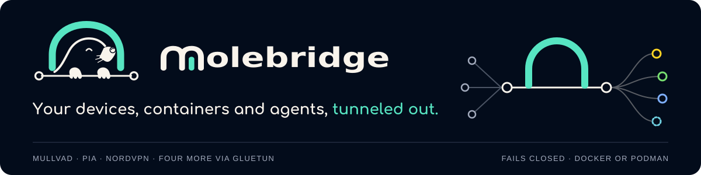
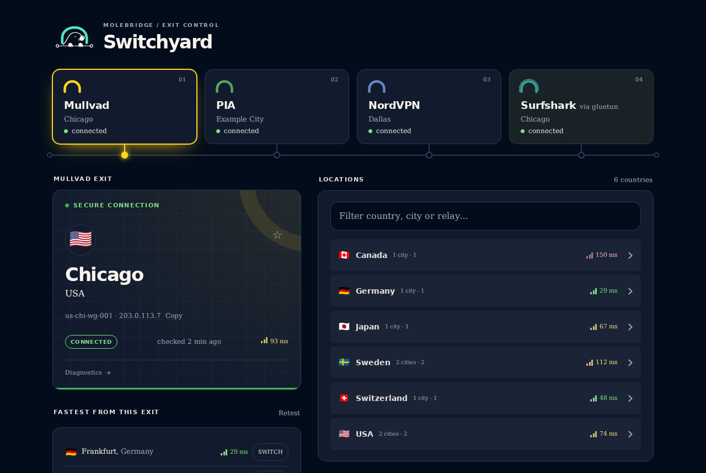

<p align="center">
  
</p>

<p align="center">
  <strong>A commercial VPN tunnel you run yourself, reached the way you choose.</strong><br>
  A NetBird exit node for your devices, a sidecar for your containers, or a
  proxy for programs that opt in, through Mullvad, PIA or NordVPN, or six
  providers through gluetun.
</p>

<p align="center">
  <a href="docs/menu.md"><strong>The menu</strong></a> ·
  <a href="docs/setup.md">Setup</a> ·
  <a href="docs/prerequisites.md">Requirements</a> ·
  <a href="docs/testing.md">Testing</a> ·
  <a href="CHANGELOG.md">Changelog</a>
</p>

---

Molebridge runs one VPN tunnel on a Linux machine you keep running and lets
traffic into it in the ways you pick. For the NetBird exit and the native
sidecar, its routing fails closed: traffic forwarded into the tunnel leaves
through it or not at all, and the exit repairs a changed rule or route as
soon as the kernel reports it. The gluetun sidecar relies on gluetun's
firewall for that, and the proxy makes a narrower promise of its own. A small
web panel, Switchyard, picks the server and shows whether the exit has
verified where your traffic leaves.

## The menu

| Way in | For | Status | Guide |
|---|---|---|---|
| NetBird exit | phones and laptops on your NetBird network, which select the exit instead of running a second VPN | run live with Mullvad, PIA and NordVPN (PIA and NordVPN [experimental](docs/providers.md)) | [NetBird exit](docs/netbird-exit.md) |
| NetBird exit with gluetun | the same, for FastestVPN, IVPN, Surfshark or Windscribe (or Mullvad, NordVPN) | experimental; run live with NordVPN only | [gluetun as a NetBird exit](docs/gluetun-netbird-exit.md) |
| Native sidecar | containers that must use the tunnel and nothing else, PIA first, with `port-sync` for qBittorrent | experimental; run live with PIA on Kubernetes only | [native sidecar](docs/native-sidecar.md) |
| gluetun sidecar | containers behind a gluetun you already run, with Switchyard picking its server | experimental; run live with NordVPN only | [gluetun sidecar](docs/gluetun-sidecar.md) |
| Proxy | programs that opt in (agents, scrapers, CI jobs), choosing a country, city or server per connection on Mullvad | experimental; drilled live on Mullvad only | [proxy](docs/proxy.md) |

The extras: [Switchyard](docs/switchyard.md), the panel;
[failover](docs/failover.md) to a backup server, off by default; the
[multi-provider exit](docs/multi-provider.md); and the
[network exchange](docs/exchange.md) for an exit and panel that share no
files. [The menu](docs/menu.md) says who each is for, what combines with
what, and each one's guarantee. The proxy's: every connection it opens
leaves through the tunnel, or fails, and it promises nothing about traffic
not sent to it.

<p align="center">
  
</p>

## Quick start

You need an always-on Linux host (amd64 or arm64, kernel WireGuard) with
Docker Engine and Compose 2.24 or later, or rootless Podman, and a VPN
account; for a NetBird exit, also a NetBird network where you are an admin
([requirements](docs/prerequisites.md)). Nothing is built and no Python is
needed on the host: the tools run from the signed image.

1. Download `molebridge-<tag>.tar.gz` and its `.sigstore.json` from the
   [latest release](https://github.com/irashack/molebridge/releases) and
   [verify the bundle and the images](docs/setup.md#1-download-and-verify)
   before you extract or run anything.
2. Let `molebridge init`, run from the verified image (`IMAGE`), write a
   Compose file and an `.env` for the ways in and extras you choose, pinned
   to the two verified images (`IMAGE` and `CORE`;
   [molebridge init](docs/setup.md#molebridge-init)):

   ```sh
   docker run --rm -it --user "$(id -u):$(id -g)" -v "$HOME/molebridge:/out" "$IMAGE" \
     init --out /out --image "$IMAGE" --core-image "$CORE"
   ```

3. Create the tunnel config and the secrets, then check and start (with
   gluetun, start it first, `docker compose up -d gluetun`, because the
   check joins its namespace):

   ```sh
   docker compose run --rm --no-deps exit check-config
   docker compose up -d
   ```

[Setup](docs/setup.md) has every command. The shipped Compose files work
without `init` too.

## Status

**Molebridge has one maintainer and is not a 1.0.** The NetBird exit with
Mullvad is its main form; the newer forms and providers are marked
experimental where they appear, until they have more live runs.
[Testing](docs/testing.md) is the record: what ran live, where and at which
revision, and what hasn't. In short, each release candidate is upgraded from
the release before it on Kubernetes (native Mullvad, PIA and NordVPN exits, a
gluetun exit, a gluetun sidecar and a PIA native sidecar) and comes back
verified before it is released. Rootless Podman with Quadlet units is
supported, but since 0.14.5 no release is tested on it
([releasing](docs/releasing.md#3-run-the-live-acceptance)). The native exits pass a tunnel-loss drill there, and since
acceptance policy 18 the proxy a live drill on a Mullvad exit. CI runs the unit, namespace-drill and
system-rig suites on every commit. Docker Engine, NetBird Cloud, phones, a
clean install from the signed bundle, a stack written by `molebridge init`,
and the shipped Compose files on any engine have not been tested.

Verify the release on your own host with the [checks](docs/verification.md)
before you rely on it, and keep a way into the host that doesn't depend on the
exit. Report vulnerabilities privately; see [SECURITY.md](SECURITY.md).

## Limits

- **Switchyard has no login unless you configure one.** By default anyone who
  can reach it can change the exit for every device that uses it. Reach it
  through an SSH tunnel or an authenticating proxy, or turn on
  [OpenID Connect sign-in](docs/access.md#sign-in-with-openid-connect), which
  has not run against a real identity provider.
- **The NetBird exit is not a kill switch on your devices.** It fails closed
  for the traffic it receives; a device that deselects the exit or loses
  NetBird uses its own connection. The proxy covers only connections sent to
  it.
- **Molebridge configures no DNS** for the NetBird exit: devices keep their
  own resolvers ([DNS](docs/operations.md#dns)).
- **Three native providers and six through gluetun, no others**
  ([other providers](docs/other-providers.md)). PIA and NordVPN are IPv4
  only.
- **One active provider per exit at a time.** A
  [multi-provider exit](docs/multi-provider.md) (experimental, since 0.14.2)
  switches between Mullvad, PIA and NordVPN, but uses one at a time. To use
  several at once, run one exit per provider and serve them from one
  [Switchyard](docs/switchyard.md#several-exits-in-one-panel).
- **NetBird only** for the exit; it was never built or tested for Tailscale or
  other overlays.

## Documentation

**Start**
- [The menu](docs/menu.md): the ways in and extras, who each is for, what combines.
- [Requirements](docs/prerequisites.md): host, accounts, NetBird and network, per way in.
- [Setup](docs/setup.md): from the signed bundle through `molebridge init` to a running stack.
- [Verification](docs/verification.md): the checks and failure drills to run before you rely on it.

**Ways in**
- [NetBird exit](docs/netbird-exit.md): the exit node for devices on your NetBird network.
- [gluetun as a NetBird exit](docs/gluetun-netbird-exit.md): the same with gluetun holding the tunnel.
- [Native sidecar](docs/native-sidecar.md): Molebridge's own tunnel, routing contract and firewall for containers.
- [gluetun sidecar](docs/gluetun-sidecar.md): Switchyard for an ordinary gluetun that your containers share.
- [Proxy](docs/proxy.md): SOCKS5 and HTTP `CONNECT` for programs that opt in.
- [Providers](docs/providers.md) and [other providers](docs/other-providers.md): how the providers differ, and why others aren't offered.

**Extras**
- [Switchyard](docs/switchyard.md) and [panel access](docs/access.md): the panel, and signing in to it.
- [Failover](docs/failover.md): moving to a backup server when the selected one keeps failing.
- [Multi-provider exit](docs/multi-provider.md): one NetBird exit for several providers.
- [Network exchange](docs/exchange.md): an exit and its panel without shared files.

**Run it**
- [Operations](docs/operations.md): health, upgrades, recovery, backups, rootless Podman, removal.
- [Troubleshooting](docs/troubleshooting.md): symptoms and fixes.

**Reference**
- [Configuration](docs/configuration.md): every setting, file and endpoint.
- [Tools](docs/tools-reference.md): the roles and tools that run from the image.
- [Architecture](docs/architecture.md): the core, each way in, trust boundaries and switching.
- [Compatibility](docs/compatibility.md): what stays the same across releases, image tags, deprecation.

**Project**
- [Testing](docs/testing.md): what has been tested, where and at which revision.
- [Roadmap](ROADMAP.md): the direction, what is built, and ideas not scheduled.
- [Changelog](CHANGELOG.md), [releasing](docs/releasing.md), [security](SECURITY.md).
- [Contributing](CONTRIBUTING.md): ground rules, layout, checks, building the image.

---

Molebridge isn't affiliated with Mullvad VPN AB, Private Internet Access,
NordVPN or NetBird. Their names are used only to say what Molebridge works with. The
panel's provider styling uses colors only, with no logos or copied assets.
Molebridge is released under the [MIT License](LICENSE), except the
Molebridge logo, which is all rights reserved
([the logo notice](docs/assets/brand/NOTICE.md)). The bundled
JetBrains Mono font is under the [SIL Open Font License](panel/static/JetBrainsMono-OFL.txt),
the bundled PIA certificate authority comes with
[PIA's MIT notice](internal/applier/PIA-CA-LICENSE.txt), and the image carries
the NetBird client under its own license; [THIRD_PARTY.md](THIRD_PARTY.md) lists
every component.
