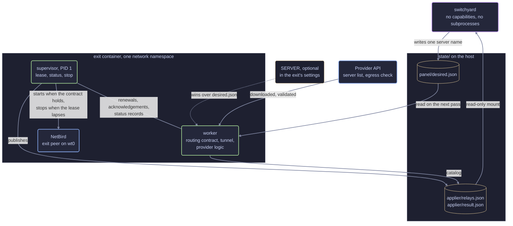
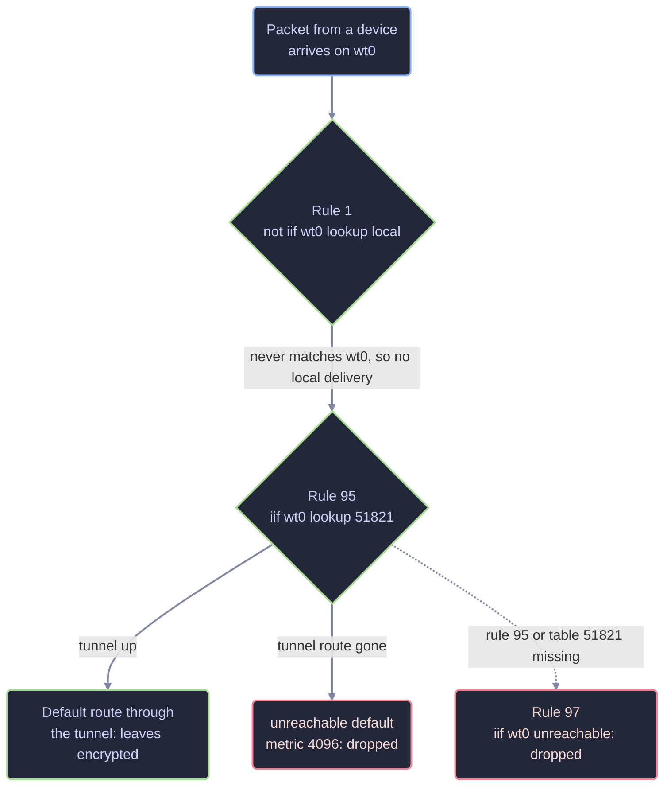
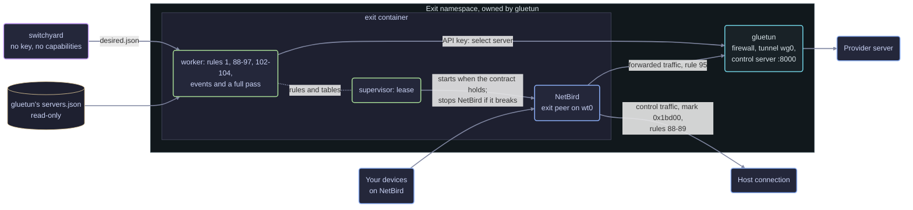
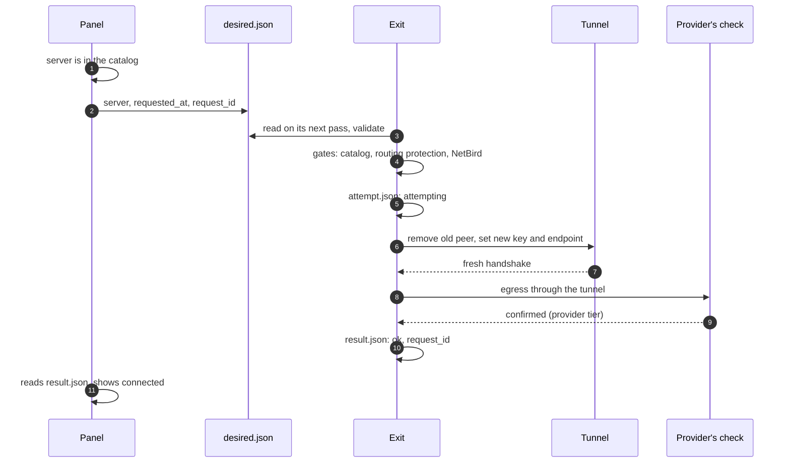

# Architecture

- [Goal and boundary](#goal-and-boundary)
- [What changed from 0.7](#what-changed-from-07)
- [Components and trust](#components-and-trust)
- [The exit container](#the-exit-container)
- [Routing contract](#routing-contract)
- [NetBird and its checks](#netbird-and-its-checks)
- [gluetun backend](#gluetun-backend)
- [The sidecar kind](#the-sidecar-kind)
- [The native sidecar](#the-native-sidecar)
- [Relay catalog](#relay-catalog)
- [Requests and switching](#requests-and-switching)
- [Status reporting](#status-reporting)
- [Panel and access](#panel-and-access)
- [Recovery and verification](#recovery-and-verification)

This page describes 0.9.3. The live runs behind it are on Kubernetes and on
rootless Podman with Quadlet units, the latest at 0.9.2
([testing](testing.md#092)); the [native sidecar](#the-native-sidecar) has run
live with PIA on Kubernetes only. [Testing](testing.md) says what the CI suites
cover and what was not run. Where a statement comes from the 0.7.0 passes, it
says so.

## Goal and boundary

A device stays on NetBird while the Internet traffic it sends to this exit
leaves through a VPN provider. If the tunnel is unavailable, that forwarded
traffic must fail rather than leave by another path.

There are two backends, and the same promise holds for both:

- **Native** (`compose.yaml`): Molebridge's own exit container owns the
  namespace and the tunnel, for Mullvad, PIA and NordVPN. The sections from
  [components and trust](#components-and-trust) to
  [NetBird and its checks](#netbird-and-its-checks) describe it.
- **gluetun** (`compose.gluetun.yaml`, experimental): gluetun owns the
  namespace and the tunnel, and the exit container joins that namespace and
  keeps the routing rules in place beside it. [gluetun backend](#gluetun-backend)
  describes what differs.

The provider logic, the panel, the request and status files and the
[status reporting](#status-reporting) are shared.

Both backends are the `overlay` kind of exit: a NetBird exit node. A second
kind, the `sidecar`, has no NetBird and carries the traffic of containers that
share the exit's namespace. It comes in two forms, both experimental. The
gluetun sidecar (`compose.sidecar.yaml`) selects and checks servers for an
ordinary gluetun, whose own firewall keeps the containers' traffic in the
tunnel, with no Molebridge routing contract ([the sidecar
kind](#the-sidecar-kind)). The native sidecar (`compose.native-sidecar.yaml`,
new in 0.9.0) is Molebridge's own tunnel, for Mullvad, PIA and NordVPN, and
Molebridge itself keeps the containers' traffic in it with a routing contract
and a firewall, so the fail-closed promise above holds for their traffic too
([the native sidecar](#the-native-sidecar)).

This is a property of the exit's namespace, not of the device. What happens
when a device deselects the exit or NetBird disconnects, and what the device
does with DNS, IPv6 and its own local routes, needs checking separately
([verification](verification.md#from-a-client)).

The sections below describe Mullvad. [Providers](providers.md#how-pia-differs)
lists what differs for PIA and NordVPN. Everything provider-specific is one
entry in the provider registry, `internal/providers`.

## What changed from 0.7

0.8.0 is a rewrite for adoption, not a change of design: the routing
contract, the status record, the verdict, the admission pipeline, the state
files and the panel's wording are the ones 0.7.0 had, so a 0.7.0 Switchyard
reads a 0.8.0 exit ([changelog](../CHANGELOG.md)). What moved:

- **One binary, one signed image.** The Python applier and panel and the
  routing shell scripts are Go in `cmd/molebridge`, selected by role. The
  native stack is two containers (`exit` and `switchyard`) where 0.7 had
  four, and nothing is built on your host. The only shell script that runs
  at runtime is `routing/gluetun-preflight`, gluetun's entrypoint wrapper;
  the rest are release and test tooling in `tools/`.
- **A supervisor and a worker instead of a gate.** In 0.7 the tunnel key and
  the provider logic were in different containers, with a gate and an
  owner-record file between the routing owner and NetBird. Now one process
  tree holds them, and a [progress lease](#the-lease) replaces the gate: if
  the routing owner stops making progress, the supervisor stops NetBird.
- **Repair on notification.** The routing owner repairs on the kernel's
  rule, route, link and address notifications. The periodic full pass
  (`ROUTING_RECONCILE_INTERVAL`, 30 seconds by default) is the fallback; at
  0.7 the 2-second pass was the repair ([drift and repair](#drift-and-repair)).
- **No shell and no `wg-quick`.** Rules, routes, the tunnel link and
  nftables are changed through netlink from the binary, which starts no
  shell.
- **NetBird runs under the binary.** Its settings, stored profile and ICE
  blacklist are checked before the daemon starts ([NetBird and its
  checks](#netbird-and-its-checks)).
- **gluetun** keeps its shape, but the 0.7 standalone form without the
  provider logic is gone ([gluetun backend](#gluetun-backend)).

## Components and trust

One image, `ghcr.io/irashack/molebridge`, and two containers from it. The
first argument of the image's entrypoint picks the role, and the role is never
guessed from the environment:

| Container | Role | What it is |
|---|---|---|
| `exit` | `exit` | Owns the namespace. One process tree: a supervisor as PID 1, a worker that holds the routing and runs the provider logic, and the pinned NetBird client. Serves no HTTP. `NET_ADMIN`, `NET_RAW` and `DAC_OVERRIDE`; everything else dropped |
| `switchyard` | `panel` | The web panel (Switchyard). Separate bridge network, loopback publish, no capabilities, no subprocesses. Runs as `PANEL_USER` (the host user's uid, or container root mapped to the host user under rootless Podman) |

The other roles run as throwaway containers or inside the exit: `health` and
`status` read the exit's runtime state, `check-config` validates settings,
`port-sync` keeps qBittorrent on a native sidecar's forwarded port
([tools](tools-reference.md#port-sync)), and `prepare-config`, `nordvpn-key`, `gluetun-auth`, `gluetun-post-rules` and
`fix-blacklist` are the setup and repair tools ([tools](tools-reference.md)).
The image is Alpine with its CA certificates, the `molebridge` binary and the
NetBird client. The binary is static (no libc, no cgo) and spawns no shell.
The image has no `wg-quick`, no `wg`, no `ip` from iproute2, no iptables and no
`bash`; busybox stays for `docker exec` diagnostics. The routing, the tunnel
and the provider logic are in the binary and talk to the kernel through
netlink.



**What the panel can and can't do.** The panel holds nothing that can change
routing: it writes one file, and the exit decides whether that file names a
server it will use. It can write only its request directory. It reads
`state/applier/` through a read-only mount and checks at start that it holds no
capabilities, that it isn't root unless you said so, and that the exit's state
is mounted read-only ([the isolation check](configuration.md#the-panels-isolation-check)).
It cannot change the relay catalog or the result. An old
`state/panel/relays.json` has no authority and is ignored. Its own outbound
connections are the TCP latency probes to relays and, only when
[sign-in](#sign-in) is configured, HTTPS requests to the identity provider.
The one thing the panel cannot check about itself is what else was mounted
into it, so keeping tunnel, credential and gluetun secret directories out of
it is a host check ([operations](operations.md#host-checks)).

**What the exit holds.** The exit reads the tunnel config (the WireGuard
private key), and with PIA the PIA login. It holds `NET_ADMIN` in the tunnel
namespace, so a compromised exit could read the live key and change routing.
It is part of the trusted base, along with the container engine, the host and
NetBird. In 0.7 the tunnel key and the provider logic were in different
containers; in 0.8.0 they share one process tree, which lets the exit own the
whole fail-closed property but removes that split. What remains is exit versus
panel. The exit's root filesystem is read-only; it writes its state directory,
the `netbird-data` volume and two tmpfs mounts: `/run`, which holds its runtime
files and scratch space, and `/var/log/netbird`. It validates everything it
reads: server lists, API answers, the tunnel config, the stored NetBird
profile, desired-state files and the panel's requests.

## The exit container

`molebridge exit` is PID 1. It is the supervisor, and it forks the worker
(`molebridge exit --worker`, started only by the supervisor, in a process
group of its own) and later the NetBird processes and the cleanup child
(`molebridge exit --cleanup`).

**The supervisor** reaps orphans, turns `TERM` and `INT` into the stop
sequence, holds the lease, starts NetBird, publishes the status record and
exits with the status that follows from why it stopped. It never touches the
kernel's routing itself and never waits on the worker: it keeps its own clock,
the boot clock, and checks the lease deadline on its own timer.

**The worker** does the work, in this order:

1. The settings were validated by the supervisor before the worker started.
   A refusal exits with status 1 and one line, before anything changes. The
   provider's own settings (the gluetun API key file, control URL and updater
   period; PIA's port-forwarding settings) are read later, after step 4 and
   before NetBird starts; a refusal there also exits with status 1. The
   supervisor also creates `state/applier` if it is missing and writes and
   removes a probe file there, so an unwritable state directory is a refusal
   too ([troubleshooting](troubleshooting.md#startup)).
2. With gluetun, wait up to 30 seconds for gluetun's control server to listen
   on loopback, and refuse if it listens on anything else.
3. For an overlay exit, subscribe to the kernel's rule, route, link and address
   notifications before the first look at the kernel, so no change between the
   look and the watch is missed. A gluetun sidecar has no contract and no
   watcher; a native sidecar has both.
4. For a native sidecar, install its [firewall](#the-native-sidecar) first.
   Then [install the routing contract](#routing-contract). Nothing forwarded
   can leave before the tunnel exists.
5. Natively (an overlay exit or a native sidecar), [bring the tunnel up](#the-tunnel);
   keep it up, and for a native sidecar read the firewall back every 2 seconds.
6. Tell the supervisor the contract holds (and, natively, that the tunnel is
   up), so it starts NetBird. The worker's first lease renewal goes out before
   steps 4 and 5, because the supervisor gives a new worker only 30 seconds
   for it.
7. Run the provider logic, once NetBird is up and its stored profile has been
   checked again: the relay catalog, the admission pipeline, the egress
   checks, the status record ([requests and switching](#requests-and-switching)).
   With a sidecar there is no NetBird, and this starts at once.
8. Watch and repair ([drift and repair](#drift-and-repair)), renew the lease,
   and write a heartbeat for the container's health check.

**The mutation owner.** Every change the worker makes to the kernel, from the
repairer and from a provider transaction alike, goes through one goroutine
with a queue. It updates the state the contract expects before it makes each
change, so the repairer never undoes a transaction in progress, and it is
never held across a provider HTTP call. It finishes or fails each operation
within 10 seconds, and reports an idle step every 2 seconds when its queue is
empty. PIA's change of address is one such transaction: install and confirm
the new rules 94 and 98, change the address, restore the exit table's default
route, then remove the old pair, with the expected state carrying both pairs
meanwhile.

### The tunnel

A native exit creates the tunnel itself (`internal/tunnel`, run as an operation
of the mutation owner). It removes a leftover link of the same name, creates a
link of kind `wireguard` through rtnetlink, sets the private key through
WireGuard's generic netlink (and the peer, for a config that carries one: a
Mullvad config does, PIA's and NordVPN's don't), assigns the addresses, sets the
MTU from the tunnel config, brings the link up and puts the default route into
the exit table. `PostUp` and `PreDown` are read as the route operations they
stand for and are never executed. A failed attempt removes the half-built link.
If bring-up fails, or the interface is later missing or down, the worker retries
after 2 seconds, then 4, doubling up to 60, and checks the interface every 2
seconds. Meanwhile the exit isn't ready, the namespace NetBird shares isn't
replaced, and forwarded traffic hits the exit table's fallback. The log says
`molebridge-exit: tunnel bring-up failed (<reason>); retrying in <n> s`, with
the failing step and the kernel's error as the reason.

### nftables

The exit uses nftables in four ways (`internal/nft`), all through netlink,
never `nft`. On an overlay exit none of them is what keeps forwarded traffic
in the tunnel; that is the [routing contract](#routing-contract). In a native
sidecar the firewall is the second of two layers.

- **Looking.** The `netbird` check lists the namespace's chains to see
  NetBird's kernel firewall ([NetBird and its checks](#netbird-and-its-checks)).
  This is a read.
- **PIA's ingress guard.** With PIA the exit installs table
  `inet molebridge_guard`, a forward hook that drops anything arriving from the
  tunnel interface and not leaving over the overlay. An earlier table of that
  name is replaced; nothing removes it.
- **PIA's port forwarding.** While forwarding is on, table
  `ip molebridge_forward` holds the DNAT and masquerade rules for the forwarded
  port ([providers](providers.md#port-forwarding)). A native sidecar has
  neither this table nor the ingress guard.
- **The native sidecar's firewall.** Tables `inet molebridge_sidecar` and
  `inet molebridge_sidecar_backstop`, installed and read back by the exit
  ([the native sidecar](#the-native-sidecar)).

Each change is one batch on a socket with a deadline of its own (10 seconds
when the caller gives none).

### NetBird as a child

The supervisor starts NetBird when, and only when, the worker has reported the
contract verified (and, natively, the tunnel up) and the lease is held. It runs
the sequence of NetBird 0.80.0's own container entrypoint, as three steps
rather than one command: `netbird service run` as a daemon in a process group
of its own; `netbird status --check live`, polled once a second for up to 30
seconds; then `netbird up`, for up to 120 seconds (a first enrollment with a
setup key can be slow). Its environment is NetBird's own `NB_*` and `WT_*`
settings plus `PATH`, `HOME`, `TZ` and a private `TMPDIR`; the setup key
reaches only these processes. NetBird's log goes to the container's tmpfs
`/var/log/netbird/client.log`, and NetBird's output is copied to the container
log with the prefix `netbird: `.

If the worker later reports it can no longer hold the contract (the contract
has not verified for `GUARD_GRACE` seconds), the supervisor stops NetBird, with
`TERM` and then `KILL` after 6 seconds, and starts it again when the contract
verifies. A lost tunnel alone doesn't stop NetBird: the exit table's fallback
already drops everything. If NetBird cannot be started, or one of its processes
exits unexpectedly, the whole exit stops and the restart policy starts it again.
A stopping supervisor starts no NetBird.

### The lease

The independent bound on a hung routing owner: if the worker stops doing its
job, something other than the worker still stops NetBird within a stated time.

Every 2 seconds the worker may send the supervisor one renewal, and is
eligible to send it only if each loop it supervises has completed a step
within that loop's bound:

| Loop | Where | Reports | Bound |
|---|---|---|---|
| The mutation owner | every exit | each finished operation, and an idle step every 2 s | 10 s |
| The kernel watcher | overlay exits and the native sidecar | each event batch, an overrun, and a 2 s timer when idle | 3 s |
| The fwmark monitor | gluetun overlay | each 2 s sample of the overlay interface's mark | 3 s |
| The NetBird log monitor | gluetun overlay | each 2 s read of NetBird's log | 3 s |

The renewal carries the launch generation, a sequence number that only rises,
and the boot-clock time of each loop's last completed step. The supervisor
rejects a renewal from a stale generation, with a sequence number not above
the last accepted, with a loop missing, or with a loop time in the future or
older than the loop's bound plus a second for transit. It answers each
accepted one with the expiry it granted, now plus `GUARD_GRACE` seconds
(default 30, 5 to 30) on its own boot clock. Rereading an acknowledgement
never extends it, and the supervisor does not wait for the worker to
notice. A new worker has 30 seconds to send its first renewal. The generation
is drawn fresh at each worker launch.

If no accepted renewal arrives in time, the lease lapses; so do the cases
where the worker exits, a NetBird process exits unexpectedly, or the worker
breaks the protocol. Each starts the [stop sequence](#the-stop-sequence). A
`SIGSTOP`ped worker is only the simplest case: a wedged mutation owner or a
stalled monitor lapses the lease as well, because the worker stops being
eligible to renew. The complete bound, from the moment a loop stalls to the
moment NetBird is gone, is the loop's bound (10 seconds at most), plus
`GUARD_GRACE`, plus the stop budget of 15 seconds: 55 seconds at the
defaults. NetBird itself is signalled when the lease lapses and gone within
7 seconds after that.

`molebridge status` shows the lease state
(`lease: held, 27 s to expiry`) from a small file the supervisor keeps under
`/run/molebridge`.

### Status publication

The supervisor, not the worker, writes `state/applier/result.json`
(atomically, mode 0644). That is what lets a hung worker's last good record
stop looking good:

- The supervisor writes a starting record when it starts, status `unknown`
  with the message `Applier starting; waiting for verification.`.
- The worker hands each finished inspection to the supervisor, with the
  lease generation and a sequence number. The supervisor drops a record from
  a stale generation or out of order, and drops every record, queued or late,
  once the lease is revoked.
- On a native overlay exit the supervisor fills in the `owner_record` check
  itself, from its own lease state at write time, and publishes between
  inspections: every 2 seconds it rewrites the last record, changing only
  `owner_record` (`pass` with an `expires_at`, or `fail`). `checked_at` and
  every other check's evidence time stay those of the last inspection, so a
  reader or bridge that judges freshness from them still sees old evidence as
  old.
- When the lease lapses or the worker dies, the supervisor writes a failure
  record, built from the last record: status `failed`, the message `exit owner
  stopped responding`, `checked_at` and the failed checks' times set to the
  lapse time, every unrelated check kept with its own earlier evidence time,
  and the selection kept. Which checks fail depends on the kind: a native
  overlay fails `owner_record`, `routing`, `netbird` and `traffic_protection`
  (a record that passed `traffic_protection` beside a failed `routing` would be
  invalid); a gluetun overlay fails `routing`, `netbird` and
  `traffic_protection` and keeps `owner_record` `n/a`; a sidecar marks its
  required checks (`peer`, `handshake` and `egress`, and for a native sidecar
  also `routing` and `traffic_protection`) `unknown`, because the worker that
  measured them is gone and nothing is invented.
  A reader then shows the failure within the lapse time rather than after its
  150-second window, except that a newer, unacknowledged panel request still
  shows as `applying`.
- A requested stop publishes nothing more: the last record goes stale after
  150 seconds.

### The stop sequence

The supervisor runs it on `TERM` or `INT` (`docker compose stop`, a recreate),
on a lapsed lease, on the worker's exit, and on a NetBird failure. Every wait
is bounded, and the budget is 15 seconds, the `stop_grace_period` the Compose
files give the container:

| Time | Step |
|---|---|
| T+0 | The lease is revoked. Publication ends (a failure record, unless the stop was requested). The worker is told to stop: it refuses new mutations and cancels provider work. Every NetBird process group gets `TERM` |
| T+6 | `KILL` to the worker's group and to any NetBird process still alive |
| T+7 | Everything is reaped, or the step that is still alive is named |
| T+7 to T+12 | The independent cleanup, `molebridge exit --cleanup`, a bounded child of the same binary. It does not run while the worker or a NetBird process is still alive; the stop is then reported as incomplete |
| T+13 | The supervisor exits |

The cleanup deletes the interfaces the exit owns: natively Molebridge's tunnel
link and NetBird's overlay link (a kernel WireGuard interface can keep
forwarding in a namespace that another container holds); with gluetun only the
overlay link, never gluetun's tunnel, which isn't ours; a gluetun sidecar owns
neither and removes nothing; a native sidecar owns its tunnel link alone and
removes only that. Every rule and the unreachable fallback stay in place, and
so does a native sidecar's firewall, so the namespace stays fail-closed.

The exit status follows why it stopped, never the cleanup outcome alone: `0`
only for a requested stop with complete cleanup; `1` for a lapsed lease, a
worker or NetBird that exited unexpectedly, a protocol violation or an
incomplete cleanup. The engine's restart policy restarts the container on a
non-zero status. The log lines are `molebridge-exit: stopping (requested)` (or
`lease lapsed`, `worker exited`, `protocol`, `netbird exited`), then
`molebridge-exit: stopped (requested, exit 0); the routing guards stay in place`, or, when something remains,
`molebridge-exit: cleanup incomplete: <what> still there; the routing guards stay in place`.

### Health

`molebridge health` is the container's health check. It is operational only:
whether the exit is verified, including on its `SERVER`, is the verdict's
question, not the health check's ([the verdict](#the-verdict)).

The worker writes a heartbeat (a line with the boot id and the boot-clock time)
on the tmpfs every 5 seconds, but only while all of these hold:

- the NetBird profile check hasn't refused, and, except for a sidecar (which
  has no NetBird), NetBird has been started;
- for the overlay kind, the routing contract is verified (natively, with the
  tunnel interface up) and NetBird is running; for a native sidecar, the
  contract is verified with the tunnel interface up and the firewall is as
  installed;
- the provider logic's own health holds: the last record is less than 150
  seconds old and from a completed check (`ok` or `failed`; startup and a
  switch in progress don't count), and the namespace is intact for the kind.
  For an overlay exit that is the tunnel interface present, routing
  protection (natively, including a live lease) and NetBird on kernel
  WireGuard with its kernel firewall. A missing peer doesn't count, because
  the pipeline puts it back and an engine that killed unhealthy containers
  would only delay that. For a gluetun sidecar it is gluetun's control server
  answering and exactly one peer. For a native sidecar it is the tunnel
  interface present, routing protection and the firewall as installed.

`health` passes while the heartbeat is no more than 15 seconds old on the boot
clock, so two missed beats still pass and three don't. When the heartbeat
can't be written, the worker says why, at most once a minute for each reason:
`molebridge-exit: not operational: <reason>`, where the reason is `the NetBird
profile check refused`, `NetBird has not been started yet`, `the routing
contract is not verified` (also a native sidecar's, when its tunnel interface is
down), `the sidecar firewall is not as installed` (a native sidecar), `NetBird
is not running` or `the pipeline reports the namespace is not intact (<what>)`. Docker and Podman don't restart unhealthy
containers by themselves; the supervisor's lease is what stops a hung worker.

A native sidecar has a second, narrower heartbeat for Kubernetes: `molebridge
health --guarded` reads `/run/molebridge/guarded`, which the worker renews every
2 seconds while the firewall reads back as installed and the routing contract
holds, whether or not the tunnel is up, and passes while it is no more than 15
seconds old. It is the exit's startup probe: a sidecar container without one
counts as started when its process runs, and the applications would start before
the firewall and the rules exist ([the startup
gate](native-sidecar.md#the-startup-gate)). Its usage line is `usage: molebridge
health [--guarded]`.

### Capabilities, and why

`cap_drop: [ALL]`, then:

- `NET_ADMIN`: the rules and routes, the tunnel link and its WireGuard
  configuration, nftables, socket marks, and NetBird's own interface. With
  gluetun's namespace, kernel WireGuard answers its peer and handshake queries
  only to a process with `CAP_NET_ADMIN` over the namespace.
- `NET_RAW`: NetBird opens an IPv4 raw socket while bringing the overlay
  interface up (Docker grants it by default, Podman doesn't), and binding a
  socket to an interface on kernels before 5.7 needs it.
- `DAC_OVERRIDE`: the merged process reads the mode-0600 tunnel config,
  credential files and panel requests, and creates, syncs and atomically
  replaces files in a state directory your host user owns. On rootful Docker
  container root is not that user; a rootless engine's container root is, and
  doesn't need it. Whether a smaller set would do hasn't been tried.

Also `no-new-privileges`, a read-only root filesystem, a 4 MiB tmpfs on
`/run` and a 16 MiB tmpfs on `/var/log/netbird`, the state directory, the
`netbird-data` volume and the namespace sysctls `net.ipv4.ip_forward`,
`net.ipv6.conf.all.forwarding` and `net.ipv4.icmp_errors_use_inbound_ifaddr`.

## Routing contract

The contract is installed before the tunnel interface exists. Installation
first adds the local-delivery guard at priority 1 and only then removes the
kernel's priority-0 `lookup local` rule, so loopback and the host interface
never lose local delivery. It then adds temporary IPv4 and IPv6 `iif wt0
unreachable` rules at priority 80, which block forwarding while the permanent
rules are built, the exit table's unreachable fallback route, and everything
else behind the guard. The temporary rules are removed only after the result
verifies; if installation fails, the worker exits with them in place and no
tunnel (`molebridge-exit: the routing contract could not be installed; no tunnel was started`).
NetBird starts only after the contract holds, in both address families. It is
stopped again if the contract stops holding for `GUARD_GRACE` seconds, and if
the worker stops answering ([the lease](#the-lease)).
`NB_INTERFACE_NAME` uses the same `OVERLAY_IF` as the routing; the exit
refuses to start if the two differ.

| Priority | Rule | Purpose |
|---|---|---|
| 1 | `not iif wt0 lookup local` | Replaces the kernel's priority-0 rule. Packets arriving on the overlay are never delivered to a socket on the exit; they fall through to rules 90–97. Loopback and every other interface keep local delivery. |
| 90 | `iif mullvad to <overlay range> lookup main` | Tunnel replies return over the overlay. Client-originated traffic cannot use this exception. |
| 94 | `from <tunnel address> ipproto icmp lookup 51821` | ICMP errors the exit generates for tunnel traffic (fragmentation needed, packet too big) return through the tunnel. With the tunnel route gone they hit the unreachable fallback, never the host's default route. IPv6 uses `ipproto ipv6-icmp`. |
| 95 | `iif wt0 lookup 51821` | Forwarded traffic uses the exit table. |
| 96 | `oif mullvad lookup 51821` | Interface-bound health probes use the same table. |
| 97 | `iif wt0 unreachable` | Terminal guard if lookup 95 or all exit-table routes disappear. |
| 98 | `from <tunnel address> ipproto icmp unreachable` | Backstop behind 94: the same ICMP errors are unreachable if rule 94 is missing, or if the exit table is empty while the tunnel is down. IPv6 uses `ipproto ipv6-icmp`. |
| — | `unreachable default metric 4096 table 51821` | Fallback when the tunnel route is absent. |

Molebridge owns priorities 0–98 in this namespace; anything else there is
removed ([drift](#drift-and-repair)). The rules in this section are the
overlay's; a native sidecar has its own set ([the native sidecar](#the-native-sidecar)). This rule 98 is the native backend's
own. The gluetun backend leaves 98 to gluetun, which uses it for something
else ([below](#why-the-routing-contract-is-policy-routing)).

A forwarded packet, one that arrived from a device on `wt0`, meets the rules
in priority order and stops at the first that decides:



Replies from the provider come back in on the tunnel and reach the device
through rule 90. Nothing in this path falls through to the main table, which
holds the host's default route.

IPv6 uses the same contract. Rule 90 is omitted for IPv6 when no IPv6 overlay
range is configured. Rules 94 and 98 exist for each family in which the
tunnel config has an address: they are installed from the config's `Address`
line, so they exist before the interface does, and they stay through tunnel
downtime. Exactly one IPv4 address and at most one IPv6 address are supported.
A PIA config has no address: the exit adds rules 94 and 98 with the address it
registers; until then the repairer leaves both priorities alone, and after
registration it repairs that pair like the other rules
([providers](providers.md#how-pia-differs)). Table numbers 0–255 are reserved
and refused. Interface names, overlay ranges and the tunnel config are
validated.

The overlay link is narrower than the tunnel (NetBird 1280 bytes, Mullvad
1420), so replies larger than the overlay MTU need an ICMP error back to their
origin. NetBird clamps TCP; UDP, including QUIC, depends on that error. The
error is generated by the exit itself, so no `iif`/`oif` rule matches it; only
its source address does. The protocol qualifier holds rule 94 to that one
purpose: an unqualified rule would force everything sourced from the tunnel
address into the tunnel, including traffic from anything else sharing the
namespace. `compose.yaml` sets `net.ipv4.icmp_errors_use_inbound_ifaddr=1` so
IPv4 errors carry the tunnel address; the kernel already selects the inbound
interface's address for IPv6. The worker warns (`molebridge-exit: warning: net.ipv4.icmp_errors_use_inbound_ifaddr is not 1; set it in compose.yaml or IPv4 path MTU discovery through the exit will fail`)
when it isn't set. Without rule 94 the errors would leave over the host's
route with an unroutable source, and large UDP flows would silently stall; rule
98 drops them instead when rule 94 or the exit table's routes are gone.

### Drift and repair

The repairer compares both families with the contract: rules 1, 90, 95, 96 and
97; rules 94 and 98 for each family with a config address; nothing else at
priorities 0–98; and an exit table holding the fallback and, while the tunnel
is up, its default route in each family the tunnel carries, nothing else. What
it promises holds for one fault at a time.

**It is driven by events.** The worker joins the kernel's rule, route, link and
address notifications before it first looks at the kernel (`internal/watch`).
A notification that could change the contract's standing (any rule change, a
route change in a table of interest, a change to the tunnel, the overlay or the
host interface, any address change, or one it can't decode) asks the mutation
owner for a repair pass. The watcher decides nothing and changes nothing. The
pass takes its own fresh look at the kernel and compares it with the expected
state at that moment, so a stale notification only ever results in a look at
the present state, and requests made while a pass is pending are one request.
A full pass also runs every `ROUTING_RECONCILE_INTERVAL` seconds (30 by
default, 2 to 60), and at once when the kernel reports that notifications were
lost (`ENOBUFS`), which logs
`molebridge-exit: netlink events were lost; running a full pass`.
The full pass is the fallback for a change the kernel doesn't announce, not
the repair itself. Reading the kernel uses a decoder of the exit's own for
rules (`internal/rtnl`), because the common library's rule listing drops the
action and attributes it doesn't know, and a rule that is wrong in one of
those would look right. A decoded rule keeps every attribute it arrived with,
so a rule with a selector the exit doesn't understand never equals one it
expects, and can still be deleted by sending the same attributes back.

A **deleted protection** is contained by the ones that remain, and put back by
the pass that its notification starts. The CI drill asserts that a single
deletion or insertion is repaired within 250 ms of the event, on a quiet
namespace ([testing](testing.md#080) records what has run).

| Deleted | Contained by |
|---|---|
| Rule 1 | No `lookup local` rule is left, so overlay packets addressed to the exit are routed by 95 and 97 like any other: into the tunnel or dropped |
| Rule 90 | Rules 95 and 97 still hold forwarded traffic; replies from the tunnel may not reach clients until 90 is back |
| Rule 94 | Rule 98: tunnel-sourced ICMP is unreachable |
| Rule 95 | Rule 97 |
| Rule 96 | Rules 95 and 97 for forwarded traffic; the exit's own traffic bound to the tunnel interface uses the main table, which has no tunnel route |
| Rule 97 | Rule 95 and the exit table's fallback |
| Rule 98 | Rule 94 |
| The fallback, tunnel up | The tunnel's default route |
| The fallback, tunnel down | Rule 97 for forwarded traffic; rule 98 for tunnel-sourced ICMP, which finds nothing at 94 and falls through to it |
| The tunnel interface | The fallback; the worker recreates the interface within about 2 seconds plus the bring-up |

An **inserted bypass**, any extra rule at priorities 0–98 (such as `lookup
main` at 50, or the kernel's priority-0 `lookup local` put back), a rule
that has the right priority but the wrong action or an extra selector, or a
foreign route in the exit table, is removed or corrected and logged by the
repair pass its notification starts. Nothing is promised about traffic between
the insertion and its removal: only root in the namespace can insert one, and
root there can defeat any guard. Two faults at once are outside the guarantee.

On the native overlay backend, a pass that has to change rules 90–97 first adds the
temporary priority-80 rule, which blocks forwarding, and removes it in the same
pass once the result verifies; if it doesn't verify, rule 80 stays until a pass
does. A native sidecar never adds it: its firewall already holds the traffic. With gluetun only the first installation uses rule 80; a repair there
doesn't add it. A wrong rule whose selectors are a subset of the right one's is rebuilt behind
a copy one priority earlier, so a repair never leaves rules 94 and 98 both
missing. A pass that finds everything in place changes nothing. Each change
is logged, for example `molebridge-exit: added IPv4 rule 97`,
`molebridge-exit: removed IPv4 rule 50: <the rule>` or
`molebridge-exit: IPv4 unreachable fallback in table 51821 restored`.

With PIA's addressless config, the repairer leaves priorities 94 and 98 alone
until PIA's registration gives the tunnel an address: until then it adds and
removes nothing there. The registration installs the pair for the new address
through the mutation owner, and from then on the repairer repairs that pair
like the other rules; a later registration retires the old address's pair ([providers](providers.md#how-pia-differs)).

The namespace drills in `internal/drill` exercise these cases against a real
kernel, in disposable namespaces inside a privileged container, in CI and with
`internal/nstest/drill.sh` ([CONTRIBUTING](../CONTRIBUTING.md#checks)). They
cover each row above, rules with the wrong action or an extra selector, event
loss by flood, and packet-level checks that nothing leaves while a repair runs.
[Testing](testing.md#080) records what has run on a live exit.

### The deletion check, and what it assumes

The mutation owner never deletes a rule or a route on its own say. Before every
deletion (an exact delete, a delete by priority, the clearing in a rebuild, a
stray copy, a route out of a table, the release of the temporary guard) it
judges the deletion against a model of the kernel that the kernel held still
for, applies the deletion to the model as the kernel would, and asks
`internal/policy` whether any protected class of traffic has gone from safe to
escaping. If one has, or the kernel kept changing so it cannot tell, the rule
stays, the pass is unverified, and the refusal is logged
(`molebridge-exit: kept IPv4 rule 98: ...`): once, and again every 10 minutes
while the same refusal recurs. A gluetun sidecar has no contract,
so nothing is checked there; a native sidecar has its own classes, below.

The model is one stable snapshot per operation, kept up to date with the
operation's own adds and deletes. The owner goes back to the kernel for a fresh
stable snapshot only when someone else changed it: the kernel stamps each
notification with the port id of the socket whose request caused it, which
tells the owner's changes from anyone else's. A change it can't attribute (no
subscription, lost events, a notification it can't decode) counts as someone
else's.

The model follows a packet through the rules the way the kernel does and
errs on the side of refusing. It judges every packet a class defines, not a
sample: traffic arriving on the overlay interface in both families (whatever
overlay prefixes are configured), ICMP the exit sends from every tunnel
address that is live or expected, packets for the exit's own addresses
arriving on the overlay, and, with gluetun, the exit's own control-marked,
client-bound and unmarked traffic. A native sidecar has only locally
generated packets, in these classes: a destination that is loopback or local,
a WireGuard-marked packet and a destination inside a `SIDECAR_LAN_CIDRS`
prefix, any of which may end anywhere; a control-marked packet, which may leave
only by the host interface or the tunnel; and every other packet, which may
leave only by the tunnel interface. A selector with a value the
model can enumerate (TOS and DSCP, port and uid ranges, `l3mdev`, a route's TOS,
source and input interface) is evaluated at every point, and the points carry a
value on each side of every bound. A selector it cannot evaluate (an attribute
of a newer kernel, a bound output interface, a dead route) is followed both
ways, a `goto` both to its target and past it, and a lookup that may fail falls
through as well; which way was taken is part of the outcome, so the same
escape under a weaker assumption is a new one. Only a refused
lookup, or a route out of the tunnel interface (for gluetun's classes, the
host, overlay or tunnel device the contract names; for a native sidecar's
control-marked class, the host interface or the tunnel), is a safe answer: a
default route out of `eth0` in the exit table is an escape however the table
is named. A deletion is simulated with the kernel's own rule and route
matching, in which an explicit zero is a wildcard, so the rule that goes is the
rule the kernel would remove.

**What a snapshot is, and what it is not.** The FIB rule dump is not atomic and
Linux gives no consistency signal for it: on the kernels measured, a dump taken
while rules change repeats or skips a rule and does not set `NLM_F_DUMP_INTR`.
A snapshot is therefore two looks that must agree, multiplicity included (a
rule that is really there twice, as `ip rule restore` leaves it, is in both
looks twice; one that is in one look only is an artifact; a repeat is believed
only after two more looks show it), and, when it holds a subscription to the
kernel's rule, route, address and link notifications, drains them behind a
barrier: a no-op `RTM_NEWLINK` for `lo`, which the kernel handles under the
rtnl lock. On kernels that notify while holding the lock the acknowledgement of
the barrier comes after the notifications of every change that was under way,
so a change that overlapped the looks is seen. From Linux 6.18 `fib_newrule`
and `fib_delrule` release the lock before they notify, and the barrier no
longer orders those notifications. A snapshot taken while another process
changes rules without pause can then, rarely, repeat or miss a rule without any
signal. The consequence is bounded to that writer's own change: the
notification of the change reaches the watcher, which asks for the next pass,
and that pass looks again. Nothing is deleted on a miss that stands, because
every deletion is judged against a model built from a stable snapshot, and
additions never depend on stability: a rule that is missing from a snapshot is
added, and an add of a rule that is there is not an error. A snapshot that the
looks, the barrier or the drain cannot vouch for is handed over marked
unstable, and an unstable snapshot authorizes no deletion, no release of the
temporary guard and no verdict. A kernel that refuses the barrier gets a longer
drain, which is a heuristic and not an ordering. The reads behind the status
record's checks change nothing, so they take a single look instead, always
marked unstable and shared for 100 milliseconds; a check that reads during a
concurrent change can be wrong for one tick and is read again on the next.

**What this does not cover.** The check, like the drift model it belongs to,
covers rules and routes that NetBird, an operator or Molebridge's own failures
change or remove: a crash half way through a repair, a request the kernel
refuses, a snapshot that is unstable or unreadable, an address that comes and
goes. A process with `NET_ADMIN` in the exit's namespace that sets out to craft
rules that defeat the check is outside it, as it is outside every guard here:
it can already route traffic anywhere, and root in the namespace can defeat any
rule it is shown. The model is a safety net for mistakes and races, not a
sandbox.

## NetBird and its checks

Rule 1 means overlay traffic is never delivered to the exit itself. A packet
arriving on `wt0` for one of the exit's own addresses, on the overlay or the
host side, is routed like any other forwarded packet, into the tunnel, or it
hits the terminal guard. The exit's own addresses become ordinary
destinations, which the LAN isolation check in
[verification](verification.md#from-a-client) already covers. Loopback and
every other interface keep local delivery.

Molebridge requires NetBird to run with kernel WireGuard and its kernel
firewall, and supports only NetBird's daemon mode, its default profile and the
settings listed in [configuration](configuration.md#what-compose-fixes-for-netbird):

- `compose.yaml` sets `NB_DISABLE_USERSPACE_ROUTING=true`.
- The exit refuses to start NetBird when `NB_DISABLE_USERSPACE_ROUTING` is not
  true, or when `NB_FORCE_USERSPACE_FIREWALL`, `NB_FORCE_USERSPACE_ROUTER`,
  `NB_USE_NETSTACK_MODE` or `NB_WG_KERNEL_DISABLED` is.
- The exit's `netbird` check, and so its heartbeat, fail unless the overlay
  interface is a kernel WireGuard link and NetBird's kernel firewall is in
  place (its IPv4 `netbird` nftables table, or an IPv4 chain whose name starts
  `NETBIRD-`; the exit lists the kernel's chains through netlink). The image
  has no iptables, so NetBird uses nftables.

Rosenpass, NetBird SSH, DNS nameservers and domain routes are not supported on
the exit peer; leave them off for its groups
([requirements](prerequisites.md#netbird)). Rosenpass's key exchange needs
local delivery from the overlay, so the exit refuses to start NetBird when
`NB_ENABLE_ROSENPASS` is set or a stored NetBird profile has
`RosenpassEnabled`.

**Before the daemon starts.** The guards name `OVERLAY_IF`, and NetBird uses the
interface its stored profile names, so the exit resolves the profile NetBird
will actually load, before anything starts: the default profile in the
identity volume (`/var/lib/netbird/default.json`), or, when that is absent, the
legacy `/etc/netbird/config.json` or `/etc/wiretrustee/config.json` that
NetBird's service manager copies into it. It supports only NetBird's default
profile at its default location: it refuses `NB_CONFIG`, `WT_CONFIG`,
`NB_PROFILE`, `WT_PROFILE` and an active profile other than `default`, and
refuses a default profile whose `WgIface` differs from `OVERLAY_IF`. It reads
the file with a reader that validates the whole JSON document, matches field
names in any ASCII case as Go's decoder does, refuses a checked field that
appears twice and a root field name outside printable ASCII, and reads only
the root object's own fields; other fields may hold anything. Every refusal is
one fixed line that prints nothing from the file, which holds the peer's
private key ([troubleshooting](troubleshooting.md#startup)).

These checks are written against the source of the NetBird release Molebridge
pins, 0.80.0; a NetBird upgrade needs them read again.

**The identity.** When the exit finds no stored profile, it says so before it
starts NetBird: `molebridge-exit: no NetBird identity found in the state directory or the legacy profile paths; NetBird will enroll a new peer`.
That is right on a first start and wrong on an upgrade that lost the
`netbird-data` volume; the message is the point at which to stop and look.
The profile and the peer's private key stay in that volume.

**The ICE blacklist.** Sharing the namespace has one consequence for NetBird
itself: by default it gathers ICE candidates on every interface it finds there,
including the exit tunnel. A candidate on that interface can never complete a
STUN exchange, and NetBird can advertise the tunnel address to peers as a
candidate. The tunnel interface therefore belongs in the peer's `IFaceBlackList`.
`compose.yaml` sets it for the first enrollment through
`NB_EXTRA_IFACE_BLACKLIST`; after that the peer's stored profile wins and
environment variables can't change it. So the exit checks the stored profile
itself:

- before the daemon starts, it requires the list to hold the tunnel interface;
  a name counts as excluded when a non-empty entry is a prefix of it, which is
  how NetBird applies the list, so the default entry `wg` covers `wg0`. A profile
  that lacks it is **refused** with a fixed line that names the repair tool
  ([operations](operations.md#netbird-interface-blacklist));
- after `netbird up`, it reads the profile again and admits no traffic unless the
  entry is in effect, because `netbird up` in daemon mode can return at once when
  the daemon is already connected, before a configuration change applies. If the
  profile isn't right, the pipeline does not run and the exit tells the
  supervisor to stop NetBird.

Only the tunnel interface is required, never the host interface: the blacklist
filters NetBird's connection candidates, and excluding the host interface would
remove the direct-connection path the gluetun backend relies on. An absent
identity is not an error and is never created by the repair tool.

The tunnel uses `Table = off` in its config. The default route through
`mullvad` goes into the exit table when the tunnel comes up, and is removed when
it goes down. The fallback and terminal guard are not removed on tunnel down.
The exit's own unbound traffic continues through the ordinary route so
NetBird and Mullvad control traffic can connect. The pipeline checks, on every
inspection:

- the overlay interface exists, is a kernel WireGuard link, and NetBird's
  kernel firewall is in place;
- every rule has the expected priority and selectors, and no `lookup local`
  rule other than rule 1's form could match the overlay interface;
- both fallback routes are present;
- the exit table has no route through another interface;
- in each family with a global tunnel address, there is a tunnel default, a
  return-path rule (94) for exactly that address and its ICMP protocol, and
  its backstop (98) for the same packets;
- the ICMP source sysctl is set;
- natively, the supervisor holds a live lease (`owner_record`).

An IPv4-only tunnel still needs the IPv6 fail-closed guards, and must have no
IPv6 return-path rule or backstop. An unknown rule ahead of the guard, an extra
selector, or a leftover temporary guard means the result can't be healthy.

A privileged actor can remove or bypass these protections. The repairer, the
lease and the health check detect drift within the intervals above; none of
them is an instantaneous defense against a compromised host.

## gluetun backend

**Experimental.** At 0.7.0 it had live passes with NordVPN on Docker and on
rootless Podman; see [testing](testing.md#gluetun-backend-pass-at-a3bb14f)
for what they covered and what they didn't. At 0.8.0 a gluetun exit with
NordVPN was upgraded from 0.7.0 on rootless Podman and reported healthy and
connected; the live drills ran on the native exits, not on this backend
([testing](testing.md#080)). The gluetun behaviors below were read in the
source of the pinned releases (gluetun v3.41.3, NetBird 0.80.0) and exercised
in isolated namespaces by the drills in `internal/drill`. The 0.7 form without
the provider logic and the panel, three containers with only a routing guard,
no longer exists: the exit container always runs the provider logic, and so
only the six providers in the registry are accepted
([gluetun as a NetBird exit](gluetun-netbird-exit.md)).

With this backend [gluetun](https://github.com/qdm12/gluetun) owns the
provider tunnel instead of Molebridge, which brings its provider list. Only
gluetun's WireGuard providers are supported. Molebridge keeps the same
promise: traffic forwarded from your devices leaves only through the tunnel,
and is dropped when the tunnel or its routes are gone.

### Containers

`compose.gluetun.yaml` replaces `compose.yaml` (set
`COMPOSE_FILE=compose.gluetun.yaml`; the settings are in
[configuration](configuration.md#gluetun-backend)). Where 0.7 had `gluetun`,
`guard`, `netbird`, `applier` and `control-panel`, 0.8.0 has three:

| Container | Image | Role |
|---|---|---|
| `gluetun` | Pinned `qmcgaw/gluetun` v3.41.3 | Owns the namespace, its firewall and the tunnel interface (`EXIT_IF`, kernel WireGuard). Starts through `routing/gluetun-preflight` |
| `exit` | The Molebridge image, `exit` role, `TUNNEL_BACKEND=gluetun` | Joins gluetun's namespace (`network_mode: service:gluetun`). One supervisor, one worker and NetBird, as in the native form; installs and keeps the rules below, reads gluetun's server list, selects servers through gluetun's control server and verifies the result |
| `switchyard` | The Molebridge image, `panel` role | Unchanged; shows the provider's name with "via gluetun" |



gluetun's control server listens on the namespace's loopback only, port 8000,
and is never published. Its role file (`secrets/gluetun/auth.toml`) gives
one role exactly five routes, `PUT /v1/vpn/settings`, `GET /v1/vpn/status`,
`GET /v1/publicip/ip`, and `GET` and `PUT /v1/updater/status`, with an API key; with any role in the file gluetun
answers no other route. Without the file gluetun would apply a public
default role that includes `PUT /v1/vpn/status`, so `compose.gluetun.yaml`
binds it in a way that makes Compose fail when it is missing. gluetun logs
a role file it can't decode with an excerpt of the offending line, which
could include the key, so gluetun starts through `routing/gluetun-preflight`,
the one runtime shell script in the project: a short busybox `sh` script that runs
inside gluetun's container as its entrypoint wrapper on every start,
including restart-policy restarts. It accepts only the exact file
`gluetun-auth` writes and refuses anything else with a fixed message that
prints nothing from the file. It also takes the kind of exit from
`MOLEBRIDGE_KIND` on the gluetun service: an `overlay` exit needs the
post-rules file `gluetun-post-rules` writes, and a `sidecar` refuses to start
gluetun while one is mounted, because a sidecar has no overlay guard behind
those rules. Anything else, or nothing, is refused. This check has to run
inside gluetun's own container: the exit shares gluetun's network namespace
but not its mounts, and can't see them.

**The API key is full gluetun administration.** gluetun authorizes by route
and method only, and `PUT /v1/vpn/settings` accepts any VPN setting: keys,
addresses, the provider, command hooks. Whoever holds the key controls the
tunnel. The exit holds it as part of the trusted base, as it holds
`NET_ADMIN` in the namespace, which already lets it read the live WireGuard
key and change routing. Only gluetun (in its role file) and the exit
mount it; the panel never does. The exit never calls `GET
/v1/vpn/settings`, which returns the WireGuard private key, and refuses to.

**The control server's address.** Because the exit shares gluetun's namespace,
it can check at start something a host check can't: that gluetun's control
server listens on loopback only. It reads `/proc/net/tcp` and `/proc/net/tcp6`,
waits up to 30 seconds for a loopback listener on the port of
`GLUETUN_CONTROL_URL`, and refuses to start if that port also has a listener on
any other address ([troubleshooting](troubleshooting.md#startup)).

### Why the routing contract is policy routing

gluetun routes every locally generated packet that lacks its own mark into
its tunnel: rule 101, `not fwmark 51820 lookup 51820`. That includes
NetBird's control traffic (management, signal, relays, STUN and the
WireGuard socket), which must use the host's connection. gluetun's firewall
drops forwarding by default, but NetBird inserts its own `FORWARD` accepts,
so the firewall can't be what keeps forwarded traffic in the tunnel. The
contract therefore sits in policy routing, ahead of gluetun's rules 98–101 and
NetBird's 105 and 110, both address families:

| Priority | Rule | Purpose |
|---|---|---|
| 1 | `not iif wt0 lookup local` | The [local-delivery guard](#netbird-and-its-checks), replacing the kernel's priority-0 rule. |
| 80 | `iif wt0 unreachable` | Temporary, while the rules are first installed. |
| 88 | `iif lo fwmark 0x1bd00/0xffffffff lookup 51822` | NetBird's control traffic uses the host table. `iif lo` limits it to packets the exit itself sends, and the exact mark leaves out NetBird's data-plane marks (0x1bd10–0x1bdff), so no forwarded packet can match. |
| 89 | `iif lo fwmark 0x1bd00/0xffffffff unreachable` | Control traffic with no host route fails here instead of reaching rule 101 and the tunnel. |
| 90 | `iif wg0 to <overlay range> lookup main` | Tunnel replies return over the overlay. |
| 91 | `iif lo to <overlay range> lookup main suppress_prefixlength 0` | What the exit itself sends to the overlay, above all the ICMP errors it returns to clients (fragmentation needed, packet too big, unreachable), uses NetBird's overlay route in the main table. `suppress_prefixlength 0` ignores main's default route, so only a route to the overlay counts. Without this rule those errors would reach gluetun's rule 101 and go into the tunnel, and path MTU discovery for clients would fail. |
| 92 | `iif lo to <overlay range> unreachable` | With no overlay route (NetBird down, `wt0` gone), that traffic fails here instead of reaching rule 101 and the tunnel. |
| 94 | `from <tunnel address> ipproto icmp lookup 51821` | ICMP errors the exit generates for tunnel traffic return through the tunnel, or hit the fallback. Follows the address gluetun gives the interface, and exists only for a family in which the tunnel interface has an address (IPv6 uses `ipproto ipv6-icmp`). |
| 95 | `iif wt0 lookup 51821` | Forwarded traffic uses the exit table. |
| 96 | `oif wg0 lookup 51821` | Interface-bound probes use the same table. |
| 97 | `iif wt0 unreachable` | Terminal guard if rule 95 or the exit table's routes disappear. Without both, a forwarded packet carrying gluetun's mark 51820 would skip rule 101 and leave by the main table; the namespace drill shows it. |

`wg0` stands for `EXIT_IF`, `0x1bd00` for `CONTROL_MARK`, 51821 for
`EXIT_TABLE` and 51822 for `HOST_TABLE`. Rules 90–92 exist for each family
with an overlay range. The exit owns priorities 0–97 and 102–104 in this
namespace and removes anything else it finds there; 102–104 are
[below](#the-exits-own-traffic-rules-102104). The native backend has no rules 91
and 92: without gluetun's rule 101, the exit's own traffic to the overlay
already reaches the main table and NetBird's overlay route.

**Exit table** (51821): the permanent `unreachable default metric 4096`
fallback, and `default dev wg0` while the interface is up with an address
in that family. Not gluetun's table 51820: when gluetun's table is empty,
traffic would fall through to later rules instead of the fallback.

**Host table** (51822): copies of the main table's default and on-link
routes through `HOST_IF`, the namespace's interface toward the host, and
nothing else, so never a route through the tunnel. It is a separate table
so that rule 88 does not depend on the main table being complete in each
family. An empty IPv6 host table is fine on a host without IPv6; NetBird's
IPv6 control traffic then fails at rule 89.


### Keeping the contract in place

gluetun deletes and recreates its interface on every reconnect, health
restart and settings change, and the kernel drops the routes through it.
The exit therefore keeps watching. It repairs on the kernel's notifications
and runs a full pass every `ROUTING_RECONCILE_INTERVAL` seconds (30 by
default) as the fallback ([drift and repair](#drift-and-repair)):

- puts back the exit table's tunnel route once the interface is up again,
  and rule 94 for its current address; until then forwarded traffic hits the
  fallback;
- refreshes the host table when the main table's host routes change;
- checks every rule at 0–97 and 102–104 in both families, adds a missing one and removes
  any other. A wrong rule whose selectors are a subset of the right one's
  could take the right one with it when deleted, so that priority is rebuilt
  behind a copy one priority earlier. The fallback route and the correct
  rules 1 and 97 are never removed otherwise;
- counts the contract as holding only when every rule and route is in place;
  an IPv4 host default route is also needed for the worker to count the
  routing as verified, but its absence doesn't stop NetBird. Readiness doesn't
  depend on the tunnel being up.

### NetBird's control mark and the monitors

Rules 88 and 89 only see marked packets. NetBird marks its sockets with its
control mark only when its advanced routing is on; with it off, its control
traffic is unmarked and reaches rule 101, the tunnel. So in gluetun mode the
exit also:

- refuses to start NetBird when `NB_USE_LEGACY_ROUTING`, `NB_SKIP_SOCKET_MARK`
  or `NB_DISABLE_CUSTOM_ROUTING` is true, or when `NB_FWMARK_BASE` differs
  from `CONTROL_MARK` (NetBird 0.80.0, the pinned release, honors that variable;
  `compose.gluetun.yaml` sets both from `CONTROL_MARK`);
- starts NetBird only when the whole contract holds, judged by the same
  definitions as the repairer, in both families: every rule in the table below
  that applies, exactly, including 102–104, and nothing else at priorities 0–97
  or 102–104; the exit table's fallback and no route in it but the tunnel
  default. An early rule such as `iif wt0 lookup main` at priority 50, or a host
  route in the exit table, keeps NetBird from starting;
- then supervises NetBird with two monitors, each a loop under the lease, so
  a stalled monitor lapses it ([the lease](#the-lease)):
  - **The log monitor** reads NetBird's own log for the current launch only
    (from the file's size when the launch began), every 2 seconds, with the
    last 512 bytes carried over so a phrase split across reads is still found,
    and starting over from the beginning if the file shrinks (a rotation or
    truncation). When it finds `advanced routing has been requested to be
    disabled` or `falling back to legacy routing`, it stops NetBird with the
    message `NetBird logged that it runs without advanced routing, so its control traffic would be unmarked`.
  - **The fwmark monitor** reads the overlay interface's fwmark through
    WireGuard's netlink interface every 2 seconds. A missing interface, a
    failed read or a wrong mark never advances the last good time; accounting
    starts at the launch. NetBird is stopped when the interface has not carried
    `CONTROL_MARK` for `FWMARK_GRACE` seconds (5 to 30, default 30), with a
    message like `wt0 has not carried the control mark 0x1bd00 for 30 seconds (last reported: absent)`,
    where the last reported value is `absent`, `off`, `nothing` or the mark seen.
    This is independent of the 30 seconds the contract may be incomplete.
  Either stop is fatal to the worker, as the 0.7 gate's was: NetBird can't be
  trusted to mark its control traffic, so the worker logs `molebridge-exit:
  NetBird gate: stopping NetBird: <reason> (see docs/troubleshooting.md)` and
  exits, the supervisor runs the [stop sequence](#the-stop-sequence) and
  publishes the failure record, and the exit stops with status 1. The
  restart policy starts it again; the monitors count from the new launch.
  NetBird is never relaunched silently by the worker that rejected it.

**The accepted residual.** The settings above are checked before launch, so
only a failed capability check inside NetBird can leave its control traffic
unmarked. NetBird runs that check at startup: it fails if setting the socket
mark, a loopback UDP dial, a deadline or a write fails, or if a test `ip
rule` add fails. All of these are local loopback and netlink operations in a
namespace where NetBird holds `NET_ADMIN` and gluetun's own rule 101 already
relies on socket marks. NetBird can sign in to management before its overlay
interface exists, so the exit can't wait for the fwmark before launching.
If the check does fail, NetBird's own TLS and relay connections go through
the provider tunnel until the log monitor sees the line, or at most
`FWMARK_GRACE` seconds until the missing fwmark stops NetBird. That is an
availability and metadata cost for NetBird's control traffic, not a leak of
your devices' traffic: rules 1, 95 and 97 hold forwarded traffic throughout.
The grace period is not a hard ceiling: the monitors sample every two seconds,
and once the exit decides to stop NetBird it allows up to 6 seconds for NetBird
to exit before killing it. Closing this gap would need a per-process identity
for NetBird inside the shared namespace (a uid or cgroup to match on), which
costs more than the gap.

### gluetun's firewall

gluetun sets DROP policies and its own accepts at startup, then runs
`/iptables/post-rules.txt` once. The `gluetun-post-rules` tool
([tools](tools-reference.md#gluetun-post-rules)) writes that file from your settings: `FORWARD` accepts
from `wt0` to the tunnel and for established replies back, an `OUTPUT`
accept for everything leaving by `HOST_IF`, and an `INPUT` accept for
NetBird's WireGuard port, in IPv4 and IPv6. These let the exit work; they
are not what keeps traffic in the tunnel. A line that fails stops gluetun, including every
`ip6tables` line when gluetun found no working ip6tables; generate the file
with `--ipv4-only` on such a host. gluetun doesn't rerun post-rules after
its in-process VPN restarts, which don't clear them either.

The `OUTPUT` accept can't name NetBird's control mark. To remove its own
rules, as it does on every reconnect, gluetun lists the whole `INPUT` or
`OUTPUT` chain and parses every line, and its parser knows only the targets
`ACCEPT`, `DROP`, `REJECT` and `REDIRECT` and the matches for a TCP or UDP
destination port and a connection state (`internal/firewall/list.go` at
v3.41.3). A mark match, or a jump to a chain of Molebridge's own, makes it
fail, and its old accepts pile up; an earlier version of these rules did
exactly that. So the accept covers the whole host interface, like gluetun's
own accept for its tunnel interface, and the kill switch for the exit's own
traffic is in policy routing instead: rules 102–104.

### The exit's own traffic: rules 102–104

gluetun's kill switch for traffic the namespace itself sends is its
firewall, and it doesn't hold through a reconnect: when gluetun empties its
tunnel table, or removes rule 101 while it restarts the VPN, unmarked local
traffic falls through to the main table and the host's default route, and
gluetun's own `OUTPUT` accept for established connections lets existing
flows out (seen on a test exit: gluetun's DNS-over-TLS connections left by
the host interface just after the tunnel went down). The exit therefore
adds, in both families, between gluetun's rule 101 and NetBird's 105:

| Priority | Rule | Purpose |
|---|---|---|
| 102 | `iif lo fwmark 0xca6c lookup main` | gluetun's WireGuard socket, which carries mark 51820 (0xca6c, fixed in gluetun v3.41.3) and which rule 101 skips, reaches its server by the main table. |
| 103 | `iif lo lookup 51822 suppress_prefixlength 0` | The host interface's own subnets: the host table's on-link routes, never its default. |
| 104 | `iif lo unreachable` | Anything else the exit sends that rule 101 didn't take into the tunnel fails: new and established flows of gluetun (DNS, health checks, updates, public IP) and of other processes in the namespace. |

Rule 103 is needed at gluetun's start. gluetun adds `default via <gateway>
dev eth0 table 200` (its inbound routing) before its own rule 98 for local
subnets exists, and the kernel checks the gateway with a route lookup that
passes the policy rules as locally generated traffic. Without rule 103 that
lookup reached rule 104, the kernel refused the route with "network is
unreachable", and gluetun stopped; this happened on a test exit during
a recreation. The exit therefore fills the host table first and adds rule 104
only once rule 103 and the host table are in place; until then it reports
the kill switch as held back and isn't ready.

What still uses the host's connection is what is meant to: NetBird's
marked control traffic (rules 88 and 89), gluetun's WireGuard socket (102),
traffic to the host's local subnets (103, and gluetun's rule 98), replies from the
host's own address (gluetun's rule 100), and loopback and the exit's own
addresses (rule 1's local lookup, including Docker's DNS at 127.0.0.11).
The exit's probes are bound to the tunnel interface (rule 96) or carry
the control mark. NetBird's unmarked DNS lookups now go into the tunnel or
fail, instead of using the host while gluetun reconnects. Forwarded traffic
never matches `iif lo`.

### The exit with gluetun

The provider logic works as it does with the native backend ([requests and
switching](#requests-and-switching)); these parts differ.

**Catalog.** gluetun's own server list, not a download: gluetun keeps it
in `servers.json` (`STORAGE_FILEPATH`), which `compose.gluetun.yaml` puts in
a volume of its own so the exit can mount only that directory,
read-only. The file is untrusted. The exit reads it with the same limits
as a download (32 MiB, no symlinks, duplicate keys refused), keeps only
the configured provider's WireGuard servers with a valid key, hostname and
IPv4 endpoint, and keeps the last good catalog when the file fails to
parse, as it does while gluetun rewrites it in place. It checks the file
every minute and reads it again when it changed, or at least every six
hours. gluetun dates each provider's data when it last changed; the panel
shows that date and calls the data stale after 30 days.
gluetun's updater refreshes it every `GLUETUN_UPDATER_PERIOD` (24 hours by
default), first one period after gluetun starts, so a fresh install would
list gluetun's built-in data, which is from 2024 for NordVPN in v3.41.3.
The exit therefore starts one refresh itself (`PUT /v1/updater/status`)
once gluetun's VPN is running and its tunnel has had a handshake in the
last 150 seconds (gluetun reports running while it still tries servers that
don't answer), when the data is older than the period or than 7 days: at most three tries per exit start, each given 15 minutes and retried 5 minutes after a failure,
reported as `server_list_update` in `result.json`. The data's age is judged on
the list read from gluetun's file since the exit started, never on the
catalogue an earlier run published, which can outlive gluetun's own list. A failed answer of gluetun's
control server counts as a try. While a refresh is owed but hasn't started,
`server_list_update` says what it waits for, and the exit logs each change of
reason once (`applier: gluetun's server list is out of date; its update waits:
...`): `waiting-for-tunnel` (no single peer with a recent handshake),
`waiting-for-vpn` (gluetun's VPN isn't `running`),
`waiting-for-control-server` (the control server failed; retried after
5 minutes) or `waiting-to-retry` (the last run failed or timed out). gluetun's updater
fetches the provider's public list from gluetun's own process, so through
the tunnel, and doesn't restart the VPN; for Surfshark and FastestVPN it
also resolves every server name. Only providers whose servers one gluetun filter selects exactly
are offered: FastestVPN, IVPN, Mullvad, NordVPN, Surfshark and Windscribe,
all by hostname. AirVPN and ProtonVPN repeat hostnames and names across
servers, and gluetun's custom provider has no list.

**Switching.** The exit sends `PUT /v1/vpn/settings` setting gluetun's
hostname filter to the selected server and clearing every other server
filter. gluetun then restarts its VPN in-process: its interface disappears
and comes back, and the exit puts the exit route back within a couple of
seconds. It reports that as switching, not as a failure, for up to
90 seconds ([gluetun's reconnection](#gluetuns-reconnection-during-a-switch)).
Success needs, as with the native backend: exactly one peer
whose endpoint and key identify the selected server in the catalog (`wg
show wg0 endpoints`, IPv4 or IPv6, matched against every address the
server lists, since gluetun connects to any of them at random; an address
listed for several servers stays unidentified), a fresh handshake, the whole contract in both families
(including rules 88, 89, 91 and 92 and the host table), and egress
confirmation at the provider's [tier](#egress-tiers): Mullvad's
`am.i.mullvad.net` and NordVPN's `ips/insights` through the tunnel, using
the same code as those native providers; the tunnel checks for the others.

**The host's own address.** The tunnel checks compare the address seen
through the tunnel with the host's own. In gluetun's namespace every socket
without gluetun's mark goes into the tunnel (rule 101), so the exit
measures the host's address over HTTPS from a socket carrying NetBird's
control mark: rule 88 sends it to the host table, and the post-rules accept
it on `HOST_IF`. Setting a socket mark needs `NET_ADMIN`, which the exit
holds.

**gluetun restarting.** Settings put at runtime are lost when gluetun
restarts; it starts again from `GLUETUN_SERVER_*`. The exit keeps the
server it last put, the last one live after a change, and the last one it
verified in `state/applier/gluetun-selection.json`. Putting the selection
back is ordinary drift correction in the [admission
pipeline](#the-admission-pipeline): the target is `SERVER` when set, else
the panel's request unless it was refused, else the **restore** target, the
last verified server (for a [tunnel-tier sidecar](#the-sidecar-kind), which
is never verified, the last one live after a change). When gluetun runs
another server, the exit puts the target back, but not while a failed
attempt waits on its backoff, never within 90 seconds of its last change,
and only once gluetun's peer can be identified or after waiting 90 seconds
for that.

### gluetun's reconnection during a switch

A PUT makes gluetun drop and recreate its interface, and the exit repairs
the routing behind it, asynchronously. While it verifies a switch
(at most the 90-second timeout), these reconnection states withhold
readiness (the `routing` check fails with the reason `reconnecting`)
without aborting the switch:

- the exit interface absent or down;
- the exit table's tunnel default route missing; the unreachable fallback
  must stay, and any other route in the table is still unsafe;
- rules 90 and 96, which name the exit interface, in the kernel's detached
  form while that interface is absent: Linux detaches them when the
  interface goes;
- the tunnel address present before its rule 94 is back;
- rule 94 for the previous address and for the current one at once, as the
  exit adds before it deletes, each at most once and in its exact form.

Anything else the full check would refuse aborts the switch with
"Routing changed during the switch; retrying after recovery.": any other
duplicate or extra rule, rule 94 for a third address, a detached rule while
the interface is present, any other rule of the contract missing or altered
(1, 88 to 92, 95 to 97, 102 to 104), the fallback gone, an extra route in the
exit table, the ICMP source sysctl unset, or NetBird no longer in kernel
mode. This is the
protective predicate, the transition predicate in `internal/contract`.
The host table is readiness, not safety. The exit reads the interface,
its addresses and the rules separately, so it reads them again, up to three
times, when the interface changed underneath (its presence or index differs
before and after, or it is present with detached rules); meanwhile the exit
isn't ready. Outside a switch, the full check applies as on every
inspection.


### Startup and recovery

`gluetun` starts first and enables its firewall, after its entrypoint wrapper
has checked the role file and the post-rules. `exit` starts once `gluetun` has
started, waits for gluetun's control server to listen on loopback, installs the
contract and starts NetBird once it holds. Compose restarts `exit` when it
restarts or recreates `gluetun` itself (`depends_on` with `restart: true`), but
an engine restart of gluetun that Compose doesn't see, a crash or a daemon
restart for example, gives gluetun a new namespace and leaves `exit` in the old
one, where it carries no traffic. Recreate gluetun and everything in its
namespace together, with `docker compose up -d --force-recreate` ([recovery](operations.md#recovery)).
The exit has no way to detect that it was left behind; the
[attachment procedure](operations.md#checking-that-containers-share-gluetuns-namespace)
is how you check.

gluetun runs its own DNS server in the namespace by default, which resolves
over the tunnel, and points its own container's resolver at it. On Docker
with OrbStack, at `4933360`, NetBird in the namespace resolved names through
it, so through the tunnel ([testing](testing.md#gluetun-backend-at-4933360-and-the-standalone-form));
so with the tunnel down it would not reach management by name. Other
engines haven't been checked.

## The sidecar kind

A sidecar (`EXIT_KIND=sidecar`) has no NetBird and no overlay. Other containers
share the exit's network namespace and send their own traffic through its
tunnel; nothing is forwarded for other devices. It has two forms, told apart by
`TUNNEL_BACKEND` and `PROVIDER`: the gluetun sidecar (`gluetun` and a
`gluetun-*` provider), described here, and the [native sidecar](#the-native-sidecar)
(`native` and Mullvad, PIA or NordVPN).

The gluetun sidecar is experimental, with one live pass at 0.7.0, NordVPN on
rootless Podman, and an upgrade of that sidecar to 0.8.0 that reported healthy
([gluetun sidecar](gluetun-sidecar.md) says what has been tested). With
`compose.sidecar.yaml`, the exit and the panel select and check servers
for an ordinary gluetun whose namespace other containers share
(`network_mode: service:gluetun`). There is no NetBird, no routing contract and
none of the overlay's gluetun post-rules; only gluetun's role-file check before
every start is shared with the gluetun backend.

The exit joins gluetun's namespace with
`NET_ADMIN` (kernel WireGuard answers its peer and handshake queries only with
it), and works as on the gluetun backend ([the exit with gluetun](#the-exit-with-gluetun))
with these differences. Its supervisor and lease run as in any exit, with the
mutation owner as their one supervised loop, and it has nothing to clean up
when it stops:

- **Checks.** The required checks are `peer`, `handshake` and `egress`.
  `routing`, `netbird` and `owner_record` are `n/a`. `traffic_protection`
  is `not-checked`: gluetun's firewall keeps the applications' traffic in
  the tunnel, and Molebridge doesn't inspect it. `app_attachment` is
  `not-checked` by the exit: `molebridge status` doesn't check it either,
  because a container can't see another's namespace attachment from inside
  its own. You check that every application in `SIDECAR_APPS` is in
  gluetun's current namespace with the [attachment procedure](operations.md#checking-that-containers-share-gluetuns-namespace).
- **Gates.** A switch needs no routing or NetBird gate, only a usable
  catalog, a listed target and readable peers.
- **Egress.** Mullvad's and NordVPN's own checks work as on the gluetun
  backend. The tunnel tier can't: in plain gluetun's namespace nothing
  leaves off the tunnel, so the host's own address can't be measured. With
  FastestVPN, IVPN, Surfshark and Windscribe, `checks.egress` fails with the
  reason `host-address-not-measurable`, and the verdict is never `ok`: it is
  `unknown`, "switched, egress unverified", with the message "Switched; the
  egress couldn't be compared with this host's address." Such a switch is
  re-checked, never applied again for that reason; a drift away from the
  target is still put back, and the restore target is the last server live
  after a change, since none is ever verified.
- **Health check.** gluetun's control server answers and there is exactly
  one peer ([readiness and health](#readiness-monitoring-and-the-health-check)).

The panel needs the kind too: `EXIT_KIND` for a single-exit panel, or
`id=<provider>/sidecar` in `PANEL_EXITS`. A record of the other kind
is never connected ("kind mismatch"). A sidecar's page says "tunnel" where an
overlay exit's says "exit".

## The native sidecar

New in 0.9.0 and experimental; run live with PIA on Kubernetes ([testing](testing.md#090)).
`EXIT_KIND=sidecar` with `TUNNEL_BACKEND=native` and Mullvad, PIA or NordVPN, in
`compose.native-sidecar.yaml`. It exists because PIA over WireGuard has no
other home: Molebridge's gluetun forms don't offer PIA. The procedure, the
settings and the Kubernetes example are in [the native sidecar](native-sidecar.md);
this section is the design.

**What it is.** The exit container owns the namespace's tunnel exactly as a
native overlay exit does: the tunnel code, the mutation owner, PIA's
registration and address transaction, the admission pipeline, the egress
checks, the lease and the status record are the same. The applications share
the namespace and send their own traffic through the tunnel. Unlike the gluetun
sidecar, Molebridge itself keeps that traffic in the tunnel, with two layers
that exist before the tunnel does and stay when the exit stops.

**The routing contract.** Rules 88 to 98 for `iif lo` (locally generated)
packets, and the exit table's fallback, in both families. The table is in
[the native sidecar](native-sidecar.md#the-routing-contract). The kernel's
repair is the overlay's: the watcher, the mutation owner, the 250 ms bound and
the deletion check all apply, with the differences that the sidecar owns
priorities 1 to 98, leaves the kernel's priority-0 `lookup local` rule alone,
has no local-delivery guard and never uses the temporary priority-80 rule.
Rules 94 and 98 follow the overlay logic, so PIA's change of address is the
same transaction. Installation puts 97 before 96, and both before the
exceptions, including in a namespace that kept a previous run's rules.

**The firewall.** Two tables in family `inet`. `molebridge_sidecar` has an
output chain with policy drop that admits loopback, the tunnel interface, the
two marks, your `SIDECAR_LAN_CIDRS` prefixes and four ICMPv6 types (router
solicitation, neighbour solicitation, neighbour advertisement and MLDv2 listener
reports), and with `SIDECAR_HOST_RESOLVERS` set drops DNS (TCP and UDP ports 53
and 853) to those prefixes before admitting them; an input chain that accepts replies on the tunnel and PIA's forwarded
port and drops the rest of what arrives on the tunnel; and a forward chain with
policy drop. It admits no IPv6 link-local or multicast destination as such:
Linux routes `ff00::/8` through the local table, so that would let an
application send UDP multicast, and UDP to a link-local address, out of the host
interface. An application cannot send the four ICMPv6 types (a datagram ICMPv6
socket sends echo requests only; a raw socket needs `CAP_NET_RAW`), so they pass
only for the kernel. `molebridge_sidecar_backstop` repeats the output chain and
has no other. A packet is sent only if every output base chain accepts it, so
deleting either table leaves the other enforcing the output policy; two faults
at once, such as `nft flush ruleset`, are outside the guarantee, as for the
routing contract. Policy routing alone does not stop a socket bound to an
interface: when the route lookup fails, the kernel assumes the destination is
on-link and sends the packet out of the bound device. The firewall drops that
packet. The exit installs both tables in one transaction, reads both back every
2 seconds (nftables announces nothing the worker subscribes to), and replaces
both in one transaction when anything differs in either. The read-back reason
names the table. The rules as `nft list ruleset` prints them are in
[the native sidecar](native-sidecar.md#the-firewall).

**Order.** The worker installs the firewall, then the contract, then builds the
tunnel; it logs `the sidecar firewall is installed` between the first two
steps. If the firewall can't be installed, it exits with
`the sidecar firewall could not be installed; no tunnel was started`. A pod's
namespace outlives the container, so the new worker replaces the old table
atomically, repairs the old rules and only then builds a tunnel.
The guard heartbeat is first written once the rules are installed, before the
tunnel is built, and the firewall's 2-second read-back renews it.

**The exit's own traffic.** The exit's requests that are not bound to the
tunnel carry the control mark (`CONTROL_MARK`) and resolve their names over
marked sockets (`netx.Request.MarkResolver`): rule 88 sends them to the main
table and the firewall admits them. They leave by the host interface, or go into
the tunnel when main routes them there (a tunnel address with a subnet puts a
route for it in main); the deletion check accepts either and no other device. This is applied once, in the exit's
`KernelSystem.Fetch`. Requests bound to the tunnel interface follow rule 96.

**Checks.** The required checks are `routing`, `traffic_protection`, `peer`,
`handshake` and `egress`. `routing` passes when the contract verifies in both
families. `traffic_protection` passes when routing passes and the firewall
verifies; its `from` is `routing` when the contract is the reason it fails and
`firewall` when only the firewall is. `netbird` and `owner_record` are `n/a`,
`app_attachment` is `not-checked` by the exit. Switch gates wait with "Waiting
for the tunnel's routing and firewall; request will retry automatically." until
both hold. A native sidecar's egress follows the overlay's rule: its providers
confirm it themselves, so the tunnel tier doesn't apply, and a failed egress
check is a measured failure.

**Supervision.** The lease's loops are the mutation owner and the kernel watcher
as on an overlay exit; there is no NetBird to stop. A lapsed lease or a dead
worker ends the exit with status 1 and a failure record whose required checks
are all `unknown`. The cleanup removes the tunnel link and nothing else.

**Port forwarding.** With PIA the exit asks for a port after each healthy switch
and the firewall's input chain admits it from the tunnel; no DNAT or ingress
guard exists ([providers](providers.md#port-forwarding)). The port is published
as `forwarded_port`, and `molebridge port-sync` can follow it for qBittorrent.

**What it does not do.** It does not tunnel or configure DNS, check that the
applications are in its namespace, or defend against a process in the namespace
that holds `CAP_NET_ADMIN`, which can change the rules, the firewall and its
marks. The applications are given no capabilities.

## Relay catalog

With the native backend, the exit downloads the catalog; with gluetun
it reads gluetun's file instead ([the exit with
gluetun](#the-exit-with-gluetun)). The exit fetches the fixed HTTPS
Mullvad relay API at startup and every six hours. Redirects and proxy environment overrides are refused. Input is size
limited, decoded as JSON with duplicate keys rejected, and checked for active
WireGuard entries, hostname shape, canonical 32-byte base64 keys, IPv4 endpoints
and bounded location strings. The optional display attributes (Mullvad-owned,
RAM-only, hosting provider) are kept only when they are strict booleans or
bounded text; they never affect whether a relay may be selected.

The PIA catalog is PIA's region list, and the NordVPN catalog NordVPN's
server list, each parsed and validated the same way by its own module; see
[providers](providers.md). Each provider's download limits are in its registry
entry: 10 MiB and 20 seconds, except NordVPN's 32 MiB and 60 seconds.

It atomically writes `state/applier/relays.json`. Failed or empty refreshes
keep the last good catalog and publish a sanitized error in
`relay-error.json`; retries happen every minute. A catalog older than 24
hours cannot authorize a new switch or a healthy result. It does not remove a
working tunnel merely because the API is unavailable.

## Requests and switching

Every change of the live server goes through one admission pipeline in the
exit's worker, whatever asked for it (`internal/applier`). The **target** is the first of:

1. `SERVER`, when set (source `configured`);
2. the panel's request in `desired.json`, unless it stands refused (source
   `panel`);
3. with the gluetun backend, the server to restore (source `restore`; see
   [gluetun restarting](#the-exit-with-gluetun));
4. none. The exit then only observes the live server (source `seed`).

Automatic retries run as `retry`, drift corrections as `reconverge`, and a
new panel request for the server the previous attempt was on, after it
failed, was refused, waited or stayed unverified, as `operator-retry`. The
source is recorded in `result.json`'s `selection`
([the status record](#the-status-record)). Molebridge never chooses another
server by itself.

When `SERVER` is set, the exit ignores `desired.json`. It validates the
name and fresh-catalog membership through the same gates.
`result.json` carries `configured_server` (null when unset); the panel
uses it to omit switching controls, refuse selection posts and ignore old
panel requests when interpreting status. Connection freshness is checked
independently. See [configuration](configuration.md#a-server-set-in-configuration).

A panel request on a native overlay exit, switched and confirmed by the
provider's own check, goes like this:



1. The panel checks membership in the read-only catalog and atomically writes
   `desired.json` with `server`, `requested_at` and a random `request_id`. It
   refuses a new request with 409 while the exit is switching
   ([panel and access](#panel-and-access)).
2. On each pass the exit reads a bounded, regular, non-symlink file. It
   waits five seconds between passes; catalog refreshes, checks and
   switches can delay the next read.
   It validates the entire schema and resolves the name only through its own
   fresh catalog. The old two-field request schema remains readable.
3. **Gates.** Before any change: a valid configuration and request, the
   target listed in a fresh catalog, for the overlay kind intact routing
   protection and NetBird in kernel mode, and readable WireGuard peers. A
   missing prerequisite leaves the request **pending**, without changing
   peers, with a message saying it will retry automatically; it is tried
   again on every pass until the prerequisites recover. A malformed request,
   or a server not in the catalog, is **rejected**: acknowledged as failed
   and not tried again until a new request arrives or, for an unlisted
   server, the catalog's server names change. A refused panel request is never the target, so with
   gluetun the restore target still applies meanwhile.
4. **Record, then change.** The exit writes `attempting` to
   `state/applier/attempt.json` before any I/O, because a lost response can
   hide success, then publishes `applying`. It removes old peers and aborts
   if removal fails, then applies the approved key and endpoint through WireGuard's
   netlink interface, each call under a deadline. With gluetun, the change is the
   control server's `PUT`.
5. **Verify** for up to 60 seconds (90 with gluetun). Success requires a
   fresh non-future handshake, separate typed Mullvad egress responses from
   HTTPS requests bound to the tunnel interface to `ipv4.am.i.mullvad.net` and
   (for an IPv6 tunnel) `ipv6.am.i.mullvad.net` (`am.i.mullvad.net` itself has
   no AAAA record), and intact routing protection. The current server is
   derived from live peer state, including the initial server from the
   tunnel configuration. A lost protective rule ends the attempt at
   once with "Routing changed during the switch; retrying after recovery."
   (with gluetun, see [its reconnection](#gluetuns-reconnection-during-a-switch)).
   At the timeout, a target that is live but not verified is **applied but
   unverified**; any other server live is a failed attempt, "Switch
   verification timed out; retrying automatically."

### The admission pipeline

The attempt's state, in `state/applier/attempt.json` (`internal/attempt`;
in `PRIVATE_STATE_DIR` when that is set, [state
files](configuration.md#keeping-the-published-files-in-memory)):

| State | Meaning |
|---|---|
| `idle` | The live server is the target and verified, or there is no target |
| `pending` | A prerequisite is missing; nothing was changed |
| `rejected` | The request is invalid or unlisted, or PIA refused the login |
| `attempting` | A change is in flight; written before its I/O |
| `unverified` | The target is live, but a check fails: the handshake, the egress check or its service |
| `failed` | The change itself failed, or verification timed out with another server live |

What happens next, in precedence order on each pass:

1. **A new target**: a new `SERVER`, a new panel request (every selection,
   including Retry and selecting the same server again, carries a new
   request id), or a new restore target. It starts a new attempt with the
   backoff from the start. A panel request made within the last 150 seconds
   is applied even when its server is already live (a PIA region registers
   again); an older one, as after a restart or an upgrade, and every other
   source inspect first.
2. **Pending** goes through the gates again on every pass. **Rejected** is
   tried again when what refused it changes: the catalog's server names,
   or with PIA the credential files.
3. **No live peer.** With the native backend the tunnel comes back from
   its config without the selected peer (the worker brings a
   lost interface back, and PIA's and NordVPN's configs have no peer), so
   the target is applied again at once from `idle` or `unverified`, and once
   per new worker generation (the worker started
   again) whatever the state, even while a failure backs off; never within
   90 seconds of the last change. With gluetun, no peer is treated like a
   peer the catalog can't name (7): gluetun's interface has no peer for a
   moment while it reconnects by itself.
4. **A due re-apply.** A failed change is applied again on a backoff of 1,
   2, 4 and 8 minutes, then every 15.
5. **A lapsed registration** (PIA, whose registry entry sets
   `registration_lapses`): the last inspection, at most two minutes old,
   found the target live with a handshake 180 seconds old or older, or
   none 180 seconds after the last change. The same server is registered
   again, after a fresh inspection confirms it, while the attempt is idle or
   unverified and the current backoff step has passed since the last
   change; each one advances the backoff. An egress-check failure alone
   never triggers it.
6. **Drift**: the live server is identifiable and isn't the target. It is
   put back only from `idle` or `unverified`, never while a failed attempt
   waits on its backoff, and never within 90 seconds of the last change.
7. **A peer the catalog can't name** counts as drift after 90 seconds; the
   wait restarts when it becomes identifiable or the target changes. With
   no fresh catalog nothing counts as drift.

Every automatic re-apply first inspects: if the target is live and passes
every check, the attempt is `idle` and nothing changes; if it is live but a
check fails, it is `unverified` (except a lapsed PIA registration, which
registers again); otherwise the change goes ahead. A change whose answer was
lost is therefore not made twice.

An `unverified` target is re-checked by the periodic check, about once a
minute, and not switched again while it stays live (`next_action:
recheck`), except that a PIA handshake stale for 180 seconds registers the
same region again on the backoff, as above; a check that passes
makes it `idle`. A `failed` attempt keeps its
message until a later check finds the target live and passing every check,
or its re-apply succeeds (`next_action: reapply`). The panel shows when
either happens next. Retry in the panel is a new request, so it applies at
once and starts the backoff over; with `SERVER` set there is no Retry
([operations](operations.md#retries)).

At start the exit reads `attempt.json`. A missing or unreadable file is
`idle`, with every trigger evaluated afresh. An attempt found `attempting`,
interrupted by a crash or a lost response, is inspected first, never
replayed: the target live means `idle` or `unverified`; anything else is a
failed attempt, "The last switch was interrupted; retrying automatically.",
applied again on its backoff after another inspection. Other states are
kept. Deadlines are kept on the boot clock with the boot's id: after a
reboot a due re-check runs at once, a re-apply waits the current backoff
step, and the 90-second guard has passed.

Some changes stay outside the pipeline because they repair or protect
rather than select: PIA's repair of an interrupted switch
([providers](providers.md#how-pia-differs)), which runs on every pass before
the gates so a damaged exit can pass them; PIA's ingress guard; PIA's port
forwarding, which runs only while the verdict is `ok`; and gluetun's
server-list refresh.

A failed check does not necessarily mean traffic is blocked: a working
approved tunnel can carry traffic while the verification endpoint is
unavailable. Routing protects against a missing tunnel; a failed check does
not install an alternate route.

## Status reporting

About every 60 seconds the exit publishes a new `result.json`, and after
each step of a switch (the worker builds the record and the supervisor writes
it, [status publication](#status-publication)). Every reader judges it with one function, so the
page, the API, the exit tabs, the browser, `/readyz`, monitoring and
`molebridge status` agree ([the verdict](#the-verdict)). Failed browser polls
immediately clear the connected indication. Last-check diagnostics are
explicitly historical.

### The status record

`result.json` is schema 2 since 0.7.0. A connected Mullvad exit's record
looks like this (`at` values shortened):

```json
{
  "schema": 2, "kind": "overlay", "backend": "native", "provider": "mullvad",
  "status": "ok", "message": "Healthy.", "checked_at": "2026-10-10T18:00:00Z",
  "server": "se-got-wg-001", "requested_server": "se-got-wg-001",
  "configured_server": null, "request_id": "0123456789abcdef0123456789abcdef",
  "selection": {"source": "panel", "outcome": "verified", "attempt": 1,
                "target": "se-got-wg-001", "next_action": null, "next_action_at": null},
  "checks": {
    "routing":            {"state": "pass", "at": "…", "fallback": true},
    "traffic_protection": {"state": "pass", "at": "…", "from": "routing"},
    "netbird":            {"state": "pass", "at": "…"},
    "owner_record":       {"state": "pass", "at": "…", "expires_at": "…"},
    "peer":               {"state": "pass", "at": "…", "server": "se-got-wg-001"},
    "handshake":          {"state": "pass", "at": "…", "server": "se-got-wg-001", "age_s": 12},
    "egress":             {"state": "pass", "at": "…", "server": "se-got-wg-001", "tier": "provider",
                           "expected_families": ["4", "6"], "families": {"4": "pass", "6": "pass"}},
    "app_attachment":     {"state": "n/a"}
  },
  "egress_ip": "203.0.113.7", "egress_ips": {"4": "203.0.113.7", "6": "2001:db8::7"},
  "egress_city": "Gothenburg", "egress_country": "Sweden"
}
```

#### Example records

`docs/examples` has a healthy record for each exit kind, as the exit writes
it, with fixed timestamps and documentation addresses:

| Kind | Backend | Example |
|---|---|---|
| Overlay | native (Mullvad) | [result-overlay-native.json](examples/result-overlay-native.json) |
| Overlay | gluetun (Mullvad) | [result-overlay-gluetun.json](examples/result-overlay-gluetun.json) |
| Sidecar | gluetun (NordVPN) | [result-sidecar-gluetun.json](examples/result-sidecar-gluetun.json) |
| Sidecar | native (PIA, port forwarding on) | [result-sidecar-native.json](examples/result-sidecar-native.json) |

The applier's test fakes produce them. A test regenerates and compares them
(`internal/applier/examples_test.go`), and checks that the verdict judges
each one connected. None was copied from a live exit, so the values are the
fakes' values: `age_s` is 1, and on a live exit `expires_at` is up to
`GUARD_GRACE` seconds after `at`. Write checks against the members and their
states, not these values.

`status` is the exit's own summary (`unknown`, `applying`, `ok` or
`failed`) and `message` its wording. `selection` says why the server is what
it is: `source` as in [requests and switching](#requests-and-switching),
`outcome` (null while a change is being made or before there is one,
otherwise `verified`, `applied-unverified`, `pending`, `rejected` or
`mutation-failed`), the number of changes made for this target, the target,
and the next automatic action (`recheck` or `reapply`) with its time.
Provider fields come on top: PIA's `port_forward`, `forwarded_port` and
`port_forward_error`, and gluetun's `server_list_update`. The 0.6 fields
`routing_ok`, `netbird_native`, `unreachable_fallback`, `exit_confirmed`,
`egress_tier`, `handshake_age_s` and `mullvad_exit_ip` are gone; the checks
replace them.

Every check has a state:

| State | Meaning |
|---|---|
| `pass` | Measured at its own `at`, and satisfied |
| `fail` | Measured at its own `at`, and not satisfied; `reason` may say why |
| `unknown` | Applies, but not measured in this inspection |
| `n/a` | Doesn't exist for this kind or backend |
| `not-checked` | Matters, but Molebridge doesn't perform it; `by` names who does |

Which checks must pass depends on the kind and backend:

| Check | Overlay, native | Overlay, gluetun | Sidecar, gluetun | Sidecar, native |
|---|---|---|---|---|
| `routing`: the routing contract, the fallback (`fallback`), and with gluetun the host table | required | required | `n/a` | required |
| `traffic_protection` | required, from `routing` | required, from `routing` | `not-checked` (gluetun's firewall) | required: `routing` and the firewall (`from` is `routing` or `firewall`) |
| `netbird`: kernel WireGuard and NetBird's kernel firewall | required | required | `n/a` | `n/a` |
| `owner_record` | required | `n/a` | `n/a` | `n/a` |
| `peer`: exactly one peer, the selected server in a fresh catalog | required | required | required | required |
| `handshake`: fresher than 180 seconds (`age_s`) | required | required | required | required |
| `egress`: every expected address family, at a tier valid for the provider | required | required | required, never the tunnel tier | required, never the tunnel tier |
| `app_attachment` | `n/a` | `n/a` | `not-checked` (the [attachment procedure](operations.md#checking-that-containers-share-gluetuns-namespace)) | `not-checked` (the same procedure) |

An inspection starts every check at `unknown`, so evidence never carries
over from an earlier one. It stops where later checks can't pass: with a
routing, NetBird or owner-record failure, egress isn't measured, and without
exactly one peer neither is the handshake. A required check counts as
passed only when all of these hold:

- its `at` is valid, not in the future and at most 150 seconds old, as for
  `checked_at`: a slow inspection's early measurements can expire while the
  record is fresh;
- for `peer`, `handshake` and `egress`, its `server` is the record's
  `server`: a pass for another server never counts;
- `handshake.age_s` is a non-negative integer, or null for a peer that never
  completed one, and below 180 for a pass;
- `egress.expected_families` is a non-empty list of `4` and `6`, every one
  of them passes in `families`, and `egress_ips` covers exactly the passing
  families;
- an overlay exit's `traffic_protection` comes from `routing`. A native
  sidecar's passes only `from` `routing` as well, and only beside a passed
  `routing`; a failure caused by the firewall alone is `from: "firewall"`.

A required check that is missing, malformed, in a state outside these five,
or recorded as `n/a` or `not-checked` makes the record invalid. A missing `kind`,
`provider` or `backend` is a mismatch, never a default; the backend follows
from the provider registry (`gluetun-*` providers are `gluetun`).

**Records without a schema** were written by 0.6 or earlier. They are read as
overlay records, and their checks show as "not reported individually",
never as passed. They count as connected only with `status: ok`,
`routing_ok: true`, `netbird_native` true or absent, provider confirmation
(`exit_confirmed`, or `mullvad_exit_ip` where that is absent) or the
`tunnel` tier for a provider that has only that, the server agreeing with
the target, and `provider` absent or the configured one. Under a sidecar
configuration such a record is a kind mismatch.

### The verdict

`internal/verdict` judges a record for one exit, against the
reader's own configuration (provider and kind) and target. Its result is a
state (`ok`, `applying`, `failed` or `unknown`), a label, reason codes, the
exit's message where it explains a failure, the egress tier, each
check's state, and the next automatic action. The panel's page, its
`/api/status` and `/api/exits`, `/readyz` and the switch gate use it, and
the page script renders the server's verdict with no rules of its own. In
the exit it decides the Gatus push, the verdict `molebridge status` prints and whether
PIA's port forwarding runs. The container health check doesn't use it
([below](#readiness-monitoring-and-the-health-check)).

In order:

1. The configured lock (`configured_server`) is read first. It holds even
   when the record is stale.
2. No readable record: `unknown`, "awaiting status".
3. The schema: none is a 0.6 record (above), `2` is read here, anything else
   is `unknown`, "unsupported status version".
4. Another kind is "kind mismatch"; another provider or backend is "provider
   mismatch". Both are `unknown`.
5. A `checked_at` more than 150 seconds old or in the future: `unknown`,
   "status stale".
6. A panel request the record hasn't acknowledged by its id: `applying`,
   "switching", while the request is less than 150 seconds old, then
   `unknown`, "request not acknowledged".
7. `status: applying`: `applying`, "switching".
8. Malformed checks: `unknown`, "invalid status record".
9. A tunnel-tier gluetun sidecar whose only failure is the unmeasurable host address:
   `unknown`, "switched, egress unverified".
10. A fresh measured failure, or a rejected or failed change: `failed`,
    "failed", even when checks the inspection didn't reach are `unknown`.
    Then expired evidence: `unknown`, "evidence expired". Then
    `status: failed`: `failed`. Then a check never measured: `unknown`,
    "not yet measured".
11. `status: ok` with every required check passed: `ok`, "connected", if the
    target agrees; otherwise `failed`, "verification failed".

**Target agreement.** The panel and `molebridge status` judge against the
same target: the configured lock from the record, or else the panel's
request in `desired.json`. The exit's applier judges against its own
resolution: its local `SERVER`, then the panel's accepted request, read again
at that moment, then the restore target.

- With `SERVER`: the record's `server` is that server.
- For a panel request: `server` and `requested_server` are both the
  requested server. A 0.6 panel could show an acknowledged `ok` on another
  server as connected.
- For any other target: `server` is the target.
- With no target, the record's own `selection.target` must match for a
  `restore`, `reconverge`, `retry` or `operator-retry` record; an observed
  `seed` can be connected with no selection made.

### Egress tiers

Egress is confirmed at one of two tiers, recorded as `checks.egress.tier`:

- **`provider`**: the provider's own endpoint says the request arrived over
  its VPN (Mullvad's `am.i.mullvad.net`, PIA's status call, NordVPN's
  `ips/insights`), for every address family the tunnel carries.
- **`tunnel`**: for a provider without such an endpoint. Every family the
  tunnel carries needs a fresh handshake; two independent IP echo services,
  asked through the tunnel interface, answering with the same address; that
  address differing from the host's own public address, measured off the
  tunnel; and, where the catalog
  lists exit addresses for the selected server, the address being one of
  them. A measurement that fails, after the one retry described below,
  fails the tier.
  The one exception is IPv6 when the namespace shows independently that it
  has no IPv6 of its own: no IPv6 route in any of its tables except the
  tunnel's, the overlay's, refusing (unreachable and the like), link-local,
  multicast and loopback ones, and no global IPv6 address on any interface
  but the tunnel and the overlay, loopback included. Then
  there is no host IPv6 address to confuse with the tunnel's. The panel
  shows the exit as connected with a "tunnel checks only" label. The checks
  are in `internal/egress`.

The tier a provider can reach is fixed in its registry entry
(`internal/providers`). A provider with its own check is never accepted
at the `tunnel` tier, so a record claiming it does not count as connected,
and a sidecar never is at that tier ([the sidecar kind](#the-sidecar-kind)); a
native sidecar's providers all have their own check.
Every native provider has its own check. With the [gluetun
backend](#gluetun-backend), Mullvad and NordVPN keep theirs, and FastestVPN,
IVPN, Surfshark and Windscribe reach only the `tunnel` tier. The `tunnel`
tier is covered by unit tests only. `tier` is null while egress is
unconfirmed.

Each egress request goes through the tunnel with a 10-second limit. When a
periodic check's egress check gets no usable answer (a timeout, a refused or
reset connection, an HTTP error, a malformed reply or, at the `tunnel` tier,
a failed measurement of the host's own address), the exit waits 10 seconds and
asks once more before it reports a failure. It does not ask again when:

- the answer doesn't confirm the egress (`mullvad_exit_ip: false` for any
  family, PIA's `connected: false`, NordVPN's `protected: false` beyond its
  cache retry, or echo answers that fail the `tunnel` checks). That counts at
  once and ends the check before any further request, so a later timeout can't
  turn it into a retry: asking again would only delay reporting traffic that
  may be leaving the wrong way;
- a switch is being verified, because the switch keeps asking until its own
  timeout;
- the check fails whatever the answer (no fresh handshake, a pending or
  rejected selection, a peer not in a fresh catalog);
- the first attempt took longer than 15 seconds.

The second attempt starts no request more than 30 seconds after it began, and
NordVPN's cache retry stops waiting then too, so a check that retries ends
within about 70 seconds. Routing protection, NetBird's mode and the peer count
are checked before any egress request and fail at once; a missing or stale
handshake fails the check after the first attempt. Until the check finishes,
the previous record stays in `result.json`, and readers still treat one older
than 150 seconds as unknown. The exit logs `molebridge-exit: applier: egress
check got no answer; asking once more`, and `molebridge-exit: applier: egress
check got no answer twice` when the second attempt fails too. A failed egress
check on the live target leaves the attempt `unverified`: re-checked, not
switched again.

### Readiness, monitoring and the health check

- `/healthz` checks panel liveness.
- `/readyz` returns 200 only when the verdict is `ok` for every exit, or for
  the one named; otherwise 503.
- The Gatus push sends the verdict against the exit's own target, never
  `applying`, so a switch in progress isn't a failure sample.
- `molebridge status`, run inside the exit container, prints the verdict
  with its reason codes, the egress tier, each check's state, the heartbeat's
  age and the lease state. It exits 0 only when the verdict is `ok`.
- The exit container's health check (`molebridge health`, Compose's
  `healthcheck`) is operational only and doesn't use the verdict; see
  [health](#health).

## Panel and access

Unless [sign-in](#sign-in) is configured, there is no application login.
Loopback publishing plus authenticated access is required; see
[access](access.md). Every request must name a published host:
loopback or an entry of `PANEL_PUBLIC_HOSTS`; anything else receives 421 before
status or a token-bearing page is served, so a DNS-rebinding page reaching the
loopback publish learns nothing (`/healthz` answers before this check). POSTs
require a cookie-bound CSRF token, and an `Origin` header, when the browser
sends one, must name a host from the same list. The request's own `Host` and
`X-Forwarded-Host` are never used as the allowlist, because a rebinding page
controls them.
Security headers restrict scripts/styles/resources to same origin,
and dashboard framing is opt-in. HTTP body size and socket time are bounded.
The static files are read once at start. The stylesheet and the script go
out gzipped (about 11 and 12 KB instead of 49 and 42 KB) to a browser that
accepts gzip; the pages and the API answers, which carry the CSRF token and
the status, are never compressed, so a compression side channel (BREACH)
has nothing to measure. A request naming a file's current content hash
(`?v=`, as the page's links do) gets `Cache-Control: public,
max-age=31536000, immutable`; any other gets `public, max-age=86400`. Each
file has an ETag, and a matching `If-None-Match` gets 304.
Remote text is escaped in HTML and assigned as text in JavaScript.
Panel logs use fixed route names and omit client addresses, origins, query
strings, bodies and unknown paths.

One panel can serve several exits on the same host (`PANEL_EXITS`; see
[Switchyard](switchyard.md)). Each exit is a pair of state directories under
`$STATE_DIR/<id>`. Every request names its exit, and a selection is checked
against that exit's own catalog and written only to that exit's
`desired.json`. The privilege split is unchanged: each exit alone applies
what its own request file asks.

Each exit's kind is the panel's own configuration, never the record's:
`EXIT_KIND` for a single-exit panel, or `id=provider/kind` in `PANEL_EXITS`.
A sidecar kind takes a gluetun or a native provider; the panel reads the
kind from its configuration, not from the record. A switch
request passes the CSRF and origin checks, then the configured lock (403),
then the exit's verdict: while it is `applying`, including a request the
exit hasn't acknowledged yet, the panel answers 409 "A switch is in
progress; wait for it to finish." A per-exit lock in the panel process
holds from reading the verdict to writing `desired.json`, so two requests
can't both pass on the same reading. A stale or unreadable status doesn't
block; the exit's gates decide.

Latency probes remain unprivileged TCP connects to port 443, cached for 15
minutes, with bounded concurrency. They run only for open pages and measure the
host-to-relay path, not end-to-end client latency. One request names at most
256 servers, a country at most 128 of them (a fixed sample when it has
more). The panel runs one latency request per exit and four in all, answering
429 beyond that before it loads anything; no lock is held while probing, and
a server already being probed is waited for rather than probed again.

### Sign-in

Sign-in is optional and off unless `PANEL_OIDC_ISSUER` is set; without it the
panel has no login. The setup is in [access](access.md#sign-in-with-openid-connect).
It is OpenID Connect's authorization code flow, written with the Go
standard library, as a public client unless a client secret file is set.

**The flow.** `/login` fetches the issuer's discovery document
(`<issuer>/.well-known/openid-configuration`, cached for an hour) and redirects
the browser to the authorization endpoint with a PKCE challenge (S256), a state
and a nonce. The nonce and the verifier are derived from the state with a
key that exists only in the panel process's memory. The browser keeps the
state, the return path and the start time in the `__Host-molebridge_login`
cookie for 10 minutes, signed with the same key, so the panel stores nothing
per sign-in and starting many sign-ins cannot push out anyone else's. When the
browser returns to `/auth/callback`, the panel checks the signature, the age
and the state, remembers that state as used so the same callback cannot be
replayed, then sends the code and the PKCE verifier to the token endpoint. A
code intercepted on its way to the browser is useless without the verifier,
which never leaves the panel except to the token endpoint.

**Discovery.** The `issuer` in the document must equal `PANEL_OIDC_ISSUER`
exactly. The authorization and token endpoints must be https (http only for a
loopback test issuer), and if the document lists the PKCE methods it supports,
S256 must be among them.

**The ID token, and why its signature is not checked.** The panel takes the ID
token from the token endpoint's answer, over a TLS connection it has verified
against the container's CA store. OpenID Connect Core 1.0 section 3.1.3.7
allows the client to rely on TLS server validation instead of checking the
signature when the token comes directly from the token endpoint. The panel
uses that allowance, so it never fetches, caches or rotates the provider's
signing keys (its JWKS). It does refuse a token whose
header says `none` or whose signature part is empty, but it does not verify the
signature. It checks that:

- `iss` is the configured issuer;
- `aud` contains the client ID, and `azp`, when present or when there are
  several audiences, is the client ID;
- `exp` has not passed and `iat` is not in the future, each allowing two
  minutes of clock difference;
- `nonce` is the one this browser's sign-in created;
- `sub` is a non-empty string.

**Groups.** They come from the ID token's groups claim. If the ID token has no
such claim, the panel calls the userinfo endpoint with the access token, and
the `sub` there must equal the ID token's. The ID token comes first because it
costs one request fewer, and because the nonce binds it to this sign-in, while
a userinfo answer is not bound to it by a nonce. Pocket ID
v2.16.0 puts the claim in both when the `groups` scope is granted (checked in
its source, not against a running instance), so the ID token path is used
there.

**Sessions.** The session lives in the panel process's memory, under a random
ID in the `__Host-molebridge_session` cookie. It has a fixed lifetime from
sign-in (`PANEL_SESSION_TTL`), is not extended by use, and is gone when the
panel restarts. At the end of it the browser goes through the flow again and
the groups are read again. The panel does not refresh tokens, and hears nothing
from the provider between sign-ins, so a change to someone's groups takes
effect at their next sign-in, within `PANEL_SESSION_TTL`. It keeps at most
4096 sessions, 16 per person: a person's extra sign-ins replace their own
oldest session, and a full table drops the one that expires first.

The cookies are `Secure`, `HttpOnly`, `Path=/`, and named with the `__Host-`
prefix, so a sibling subdomain can't set or overwrite them. They are
`SameSite=Lax` because the browser comes back from the provider by a
cross-site redirect and must bring them. The CSRF token that protects `POST
/select` and `POST /logout` is also bound to the session, and with sign-in on
the CSRF and last-exit cookies are `Secure` too. A `/login` request whose
`X-Forwarded-Proto` says it arrived over plain http is sent to the canonical
https address once (marked `canonical=1`, so a proxy that always says http
cannot loop); the header only steers that redirect.

**Authorization.** The session holds the exits the person's groups grant. An
exit they are not granted is treated everywhere as one that doesn't exist; the
[endpoint table](configuration.md#panel-endpoints) lists the answers. A person
whose groups grant no exit gets no session.

With sign-in on, the panel reads its cookies with a strict parser: a cookie
must appear once, by its exact name. Without sign-in it reads them the way
Python's `http.cookies.SimpleCookie` did in 0.7, which the Go panel
reproduces on purpose so that behavior doesn't change. That reader would take
`a=x __Host-molebridge_session=…` as two cookies, letting a cookie planted
from a sibling subdomain or over plain http stand in for the session, which is
why sign-in doesn't use it.

**Logs.** Each sign-in, refused sign-in, sign-out and switch writes one line to
the panel's standard error, for example
`switch: user=<name> sub=<subject> exit=<id> server=<server>`. The name is
`preferred_username`, else `email`, else the subject; both are reduced to
letters, digits and `._@+-` and 64 characters. Tokens, codes, cookies and
session IDs are never logged. Switches are logged only with sign-in on.

**Sign-in adds an outbound trust boundary.** Without it, the panel's only
outbound connections are latency probes. With it, the panel makes HTTPS
requests to the identity provider: discovery, the token endpoint, and userinfo
only when the ID token lacks the groups claim. A failed discovery is not
retried for 30 seconds. With an https issuer every endpoint must be https. The
requests name themselves `User-Agent: molebridge-panel`; an issuer behind
Cloudflare refused Python's default agent with 403 in the first live test, at
0.7.0, and the Go panel keeps the name. These follow the URLs from the
discovery document. Environment proxy settings are ignored, redirects are not
followed, each request times out after 10 seconds, a response is cut off at
256 KiB, and a JSON object with a duplicate key is refused. The panel
container therefore needs a route to the provider.

Identity rests on that TLS connection and the container's CA store. An issuer
that is compromised, or a certificate authority that mis-issues a certificate
for it, can sign anyone in as any member of any group. The panel still holds
no capabilities and runs no subprocesses. With a public client it holds no
secret either; with `PANEL_OIDC_CLIENT_SECRET_FILE` it holds that one file.

Sign-in has been tried live with Pocket ID v2.16.0, as an admin only; see
[testing](testing.md#sign-in-pass-at-62a0170).

## Recovery and verification

There is no recovery helper. The exit recovers itself from what it can: it
repairs rules, restores the tunnel, restarts NetBird, and stops and exits when
its worker stops answering, so that the restart policy starts it clean. What it
cannot repair is a container left in a namespace that no longer exists, because
no process inside a namespace can see that another container replaced its
owner. For the gluetun forms that means recreating gluetun and everything that
shares its namespace together, with `docker compose up -d --force-recreate`,
and then checking the attachment ([operations](operations.md#recovery)). The
same holds for a native sidecar under Compose, where the exit owns the
namespace its applications share; its rules and firewall keep the old
namespace closed meanwhile, and in a Kubernetes pod, whose namespace survives a
container restart, nothing needs recreating. A native overlay exit has one
container that owns its namespace, so recreating it is enough, and NetBird's
identity stays in the `netbird-data` volume.

A recreated exit is operational when its health check passes; whether it
carries traffic to the provider is `molebridge status`, which reads the exit's
own record. Nothing in `molebridge` deletes a volume or enrolls a new peer on
its own: a missing identity is reported at start, in a line, and the exit then
enrolls a new peer with the setup key ([NetBird and its
checks](#netbird-and-its-checks)).

[Verification](verification.md) covers the live deployment; the namespace
drills in `internal/drill` cover the routing contract against a real kernel in
CI. Linux Docker and NetBird Cloud end to end have not been tested yet at any
version; see [testing](testing.md).
