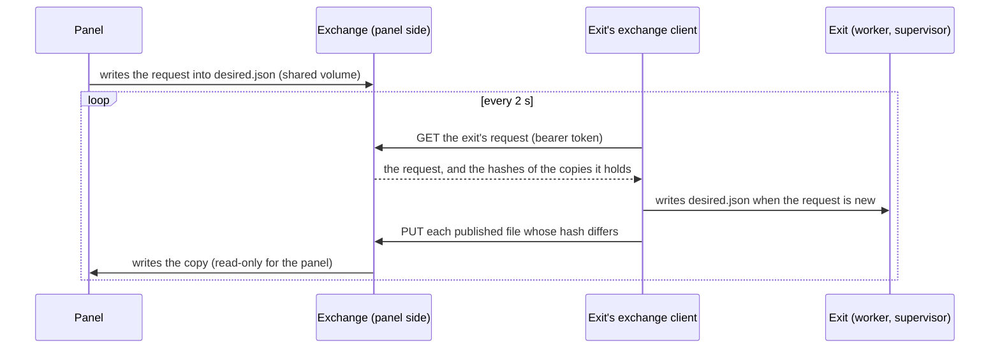

# Design: exchanging requests and status over the network

**A design note for review. Nothing here is built.** It works out the
roadmap entry [exchanging requests and status over the
network](../ROADMAP.md#exchanging-requests-and-status-over-the-network), the
first step of the [direction](../ROADMAP.md#direction). Once it's agreed, the
user-facing pages (configuration, architecture, operations, compatibility)
get the parts that ship, and this note is deleted.

## The problem

The panel and an exit talk through files. The panel writes
`state/panel/desired.json`; the exit's supervisor writes
`state/applier/result.json` and its worker writes `relays.json` and
`relay-error.json`. Each mounts the other's directory: the panel reads
`applier/` through a read-only mount, and the exit reads `panel/`. That ties
them to one filesystem:

- On Kubernetes the panel and the exit share a volume, often across
  namespaces, and one panel serving several exits mounts every exit's state.
  A node-local volume pins all of them to one node. Most NFS exports squash
  root and can't hold the exit's root-owned 0600 files, and user-namespaced
  pods may not mount NFS at all. Today the
  [native sidecar's Kubernetes example](native-sidecar.md#kubernetes) has no
  panel and sets `SERVER` for that reason.
- More ways in ([direction](../ROADMAP.md#direction)) would mean more
  readers and writers of shared directories.

## The idea: carry the files, change no reader

The file contract stays exactly as it is on both sides. Two new pieces carry
it over HTTP:

- **On the exit,** a small client copies the panel's request into the exit's
  own `state/panel/desired.json`, and copies the exit's published files to the
  panel side.
- **On the panel's side,** a new container, the **exchange**, receives those
  files and writes them into the panel's own `state/<id>/applier/`, and hands
  out the panel's `desired.json` to the exit that asks.

The worker still reads `desired.json` from its own disk, and the supervisor
still writes `result.json`. The panel still reads the same four paths per
exit, through the same read-only mount, so its
[isolation check](configuration.md#the-panels-isolation-check) is unchanged.
`molebridge status`, `molebridge health`, `port-sync` and any bridge in the
exit's pod read the exit's own files, as now. Neither side mounts the other's
volume, so each can be scheduled independently. Moving an exit means moving
its own volume.



## Decisions, and why

### The exit only makes outbound requests

The exit serves no HTTP today ([components and trust](architecture.md#components-and-trust)),
and this keeps it that way. The exit opens one more kind of outbound
connection, like the [Gatus push](operations.md#gatus) it already makes. The
exchange listens, once, for every exit. That also fits the topology: one
panel and many exits, so the hub is the panel's side.

### The client runs inside the exit, as its own child process

A separate container in the exit's namespace can't reach the panel in every
form. In the gluetun form, unmarked traffic the namespace sends goes into
gluetun's tunnel (rule 101) or fails (rule 104), except to the host's own
subnets ([rules 102–104](architecture.md#the-exits-own-traffic-rules-102104)), and in
the native sidecar, unmarked traffic stays in the tunnel or the LAN prefixes
([the exit's own traffic](native-sidecar.md#the-exits-own-traffic)). The
client has to use the same marked sockets as the exit's other control
requests (the provider downloads, the Gatus push), through `internal/netx`.

It runs as a third child of the supervisor, a new role `exchange-client`,
beside the worker and NetBird, not inside either of them:

- **Not in the worker,** so a slow or hostile panel can't delay the mutation
  owner, the kernel watcher or a renewal of the lease.
- **Not in the supervisor,** so PID 1 stays what it is: the lease, status
  publication and the stop sequence.
- **Outside the lease.** Its failure stops nothing: the exit keeps routing on
  its last request, and the supervisor restarts the client with a backoff (one
  second, doubling to a minute). The panel then shows the exit as
  unreachable (below), never as connected.

What it may do: read `applier/result.json`, `relays.json` and
`relay-error.json`; write `panel/desired.json`; make HTTP requests to one
configured URL. It never touches routing, the tunnel or NetBird, and it is
started only when `EXCHANGE_URL` is set.

### The panel's side is its own container, not the panel

The exchange holds every exit's token and writes the copies the panel reads.
In the panel, that would make the panel the writer of what it displays and
put credentials in the one container that must hold nothing. As its own
container (role `exchange`), it keeps both out of the panel:

- No capabilities, not root (the same self-check as the panel's first two).
  It runs as `PANEL_USER`, the panel's user, so it can read the panel's
  `desired.json` (mode 0600).
- It listens on its own port, which only the exits need to reach. That's never
  the panel's port, so a reverse proxy or a sign-in in front of the panel
  never exposes it, and its requests never meet the panel's sign-in.
- It writes `state/<id>/applier/` (read-only for the panel) and
  `state/<id>/exchange.json` (below); it reads `state/<id>/panel/desired.json`
  and never writes it.

The panel and the exchange share a volume in the panel's pod, or a host
directory under Compose. That is one pod's volume, not one shared across
pods.

### The protocol

HTTP/1.1, JSON, standard library only. Every request carries
`Authorization: Bearer <token>`, the exit's own token, never in the URL. The
exit's id is in the path and must match the token's.

- **`GET /v1/exits/<id>`**, every 2 seconds, answers:

  ```json
  {"schema": 1,
   "desired": {"server": "se-sto-wg-001", "requested_at": "…", "request_id": "…"},
   "have": {"result.json": "<sha256>", "relays.json": "<sha256>", "relay-error.json": "<sha256>"}}
  ```

  `desired` is the panel's request as it stands in `desired.json`, or null.
  `have` holds the hashes of the copies the exchange holds, so a restarted
  exchange with an empty directory gets everything again on the next round,
  with no separate handshake.
- **`PUT /v1/exits/<id>/files/<name>`**, for each of the three files whose
  hash differs, with the file's bytes as the body. On a native exit
  `result.json` changes every 2 seconds (the lease), so that is one small
  request every round; `relays.json`, up to 16 MiB, goes after each catalog
  refresh (about every six hours) and after an exchange restart.

On the exit, the client writes `desired.json` (atomically, mode 0600) only
when the answer's request differs from the file's. It never deletes it, so
an exchange that lost its volume, or that has no request, leaves the exit on
its last request. That's the rule the roadmap asks for: an unreachable panel
is the same as no new request.

### Both sides validate what they receive

Each side treats the other as untrusted input
([the properties](../AGENTS.md#preserve-the-properties)):

- **The client** reads at most 4 KiB plus the envelope, refuses invalid
  UTF-8, duplicate keys and unknown schemas, and checks `desired` against the
  request schema before writing it. The worker validates the file again, as
  it does today, and resolves the server only through its own catalog.
- **The exchange** refuses a body over the file's limit (16 KiB for
  `result.json`, 4 KiB for `relay-error.json`, the provider's catalog limit
  for `relays.json`), invalid UTF-8, duplicate keys and anything that isn't a
  JSON object. It checks that a `relays.json` names the exit's provider, and
  writes atomically with mode 0644. The panel validates every file again when
  it reads it, as it does today.

### The link has its own state, and an unreachable exit is unknown

A copy of `result.json` that stops arriving would be judged as it is today:
after 150 seconds it is stale, and once its `owner_record` expiry passes,
the check fails. That would show a link failure as an exit failure. So the
exchange writes `state/<id>/exchange.json` after every round: `schema`,
`last_contact_at` (on the exchange's clock), each file's `received_at`, and
`clock_offset_s`, the difference between the exit's `X-Molebridge-Sent-At`
header and the exchange's clock.

The verdict gets one more input. For an exit configured for the network
exchange, an `exchange.json` with no contact for 15 seconds (or none at all)
makes the verdict `unknown` with a new reason code, `exit-unreachable`. That
reason comes before every judgment of the copy, so a lapsed lease or an old
`ok` is never shown as live. A new reason code is allowed within the
[status endpoints' promise](compatibility.md#the-panels-status-endpoints);
schema 2 of the status record is unchanged.

### Tokens and transport, following the Gatus push

- **One token per exit,** at least 32 random bytes. On the exit it goes in
  `secrets/applier.env` as `EXCHANGE_TOKEN`, like `GATUS_TOKEN`; on the
  exchange, one file per exit id in a secrets directory. The exchange compares
  tokens in constant time. Neither side logs a token, a URL with credentials,
  or a body.
- **TLS when it crosses a network.** The client accepts `https://` with an
  optional pinned CA and server name (`EXCHANGE_CA_FILE`,
  `EXCHANGE_TLS_NAME`, which `netx` already supports), and `http://` with the
  same start-up warning the Gatus push gives for a host other than loopback.
  The exchange serves TLS from a mounted certificate and key, or plain HTTP
  for a trusted pod network.
- **What a stolen token allows:** reading that exit's requests, and writing
  that exit's copies, which the panel shows. It doesn't allow changing routing,
  and the exit still checks every request against its own catalog.

### Clocks

The status record's times are the exit's wall clock, judged by the panel's.
That's harmless on one host and not across nodes: `owner_record`'s expiry is
30 seconds ahead at the defaults. The exchange measures the offset on every
round (above); the panel shows it, and with more than 10 seconds of offset
the verdict is `unknown` with the reason `clock-skew` instead of judging
times it can't compare. The fix is the host's time sync, which the
[requirements](prerequisites.md) will name for this form.

## Settings

All new, and all optional. Nothing changes for an exit without
`EXCHANGE_URL`, and the file exchange stays the default for Compose and
single-host setups.

| Where | Setting | Meaning |
|---|---|---|
| exit | `EXCHANGE_URL` | The exchange's base URL; empty (the default) means files only |
| exit | `EXCHANGE_EXIT_ID` | The exit's id at the exchange, as in the panel's `PANEL_EXITS` |
| exit | `EXCHANGE_TOKEN` | In `secrets/applier.env` |
| exit | `EXCHANGE_CA_FILE`, `EXCHANGE_TLS_NAME` | Optional, for `https://` |
| exchange | `PANEL_EXITS` | The same list as the panel's, for the ids, providers and kinds |
| exchange | `EXCHANGE_LISTEN` | Address and port; a host is required, as with the panel |
| exchange | `EXCHANGE_TOKENS_DIR`, `EXCHANGE_CERT_FILE`, `EXCHANGE_KEY_FILE` | Token files by exit id; optional TLS |
| panel | `PANEL_EXITS` | Gains a way to mark an exit as reached over the network (form to be settled; perhaps `id=mullvad@network`), so the panel expects `exchange.json` for it |

## What it doesn't change

- No change to routing, the tunnel, NetBird, the lease or the fail-closed
  property: forwarded traffic doesn't touch any of it. The client's requests
  are control traffic on the exit's marked host path, like the provider
  downloads.
- No change to schema 2, the state files' names and fields, the Compose
  service names, the routing contract or the exit codes. The additions are a
  role on each side, `exchange.json`, two reason codes and the settings above
  ([compatibility](compatibility.md)).
- `molebridge status` and the health checks keep reading the exit's own
  files.
- An exit that starts with an empty `applier/` recovers from the panel's
  request alone: the client fetches it on its first round. A move then
  carries only the NetBird profile and the tunnel credentials, which are
  already mounted from files.

## How it would be tested

- **Unit:** the exchange's handlers (tokens, ids, limits, duplicate keys,
  provider mismatch, atomic writes, `have`); the client's round against a fake
  exchange (a new request written once, never deleted, an oversized or
  malformed answer refused, a restarted exchange refilled); the verdict's
  `exit-unreachable` and `clock-skew`; the supervisor restarting a failed
  client without touching the lease.
- **In-process:** an exchange, a client and a panel over loopback, with a
  switch acknowledged end to end.
- **Live, on Kubernetes, with the exit and the panel on different nodes:** a
  switch; the switch, tunnel-loss and repair drills in
  [verification](verification.md); the exchange restarted with an empty
  volume; the panel unreachable for a minute (the exit keeps its server, the
  panel shows `exit-unreachable`); the exit recreated with an empty
  `applier/`; a token mismatch; and in the gluetun form and a native sidecar,
  that the client reaches the exchange and nothing else in the namespace can
  use its path.
- **Compose:** the file exchange still passes the existing checks
  unchanged.

## Open questions

1. **Separate `exchange` container, or a listener inside the panel?** This
   note proposes a separate container, to keep tokens and the copies' writer
   out of the panel. Inside the panel would save one container and one shared
   volume.
2. **How strict about transport?** This note follows the Gatus push: warn on
   plain `http://` to anything but loopback. Refusing it unless an explicit
   setting allows it would be stricter, at the cost of a setting most pod
   networks need.
3. **Poll every 2 seconds, or long-poll?** Polling keeps both sides simple and
   a switch's extra latency under 2 seconds. A long-poll on `GET` would cut
   idle requests to one per exit per minute.
4. **How to mark a network exit in `PANEL_EXITS`.** The panel needs to know so
   that a missing `exchange.json` reads as unreachable, not as an old-style
   exit with no copy yet.
5. **Clock skew threshold.** 10 seconds against a 30-second lease expiry is a
   guess; it may be better tied to `GUARD_GRACE`.
