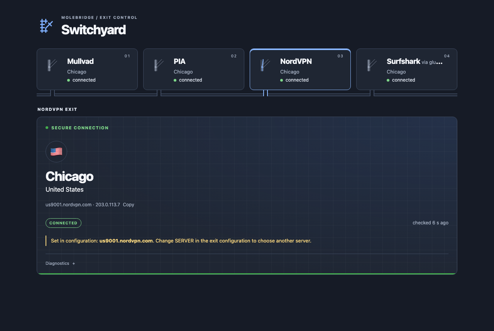
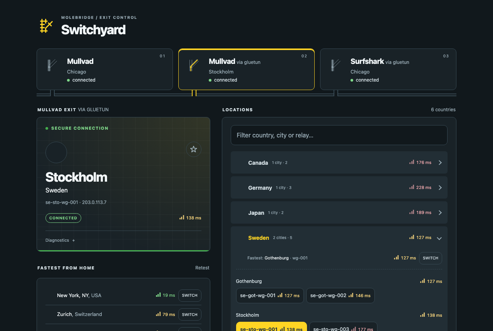

# Switchyard, the panel

Switchyard is the web page where you pick the exit's server. It is the
`panel` role of the Molebridge image, a Go program in a container of its own,
and every Molebridge stack runs one on `127.0.0.1:8095` (`PANEL_PORT`; it
listens on 8080 inside the container). One Switchyard can also
serve several exits on the same host; see
[several exits in one panel](#several-exits-in-one-panel).

By default it has no login. Put it behind [authenticated access](access.md)
before anyone else can reach it, or turn on its
[OpenID Connect sign-in](access.md#sign-in-with-openid-connect).

## An exit set in configuration

When an exit has `SERVER` set, the page shows "Set in configuration" and the
configured server name. That exit is read-only: no location, fastest, saved
or retry switching controls are shown, in the full page or the embed. Its
connection state and Diagnostics remain available. Other exits in the same
panel can still be switched.

<p align="center">
  
</p>

The panel learns the setting from the exit's `result.json`, through its
existing read-only mount. A stale status keeps the exit read-only and shows
its connection as unknown. A `POST /select` for that exit is refused with
403 and "Exit is set in configuration; change SERVER to choose another
server." `/api/status` gives the configured name as
`verdict.configured_server`; `desired` is null.

Change or clear `SERVER` in the exit's configuration and apply it by
[recreating the exit](operations.md#recovery). [Configuration](configuration.md#a-server-set-in-configuration)
explains validation, startup and what happens to a previous panel request.

## Switching

The page has three parts:

- **The current exit.** It shows the server or region, the egress address and
  a state:

  | State | Meaning |
  |---|---|
  | connected | Every check the exit needs passed in the last 150 seconds, on the server you selected |
  | switching | A switch is running, or the exit hasn't picked up your request yet |
  | failed | The last switch, or the latest periodic check, failed |
  | unknown | The status can't be confirmed: stale or unavailable, not yet measured, or not readable by this panel ([troubleshooting](troubleshooting.md#the-panel)) |

  Every page, `/api/status`, the tabs and `/readyz` show the same
  [verdict](architecture.md#the-verdict).

  Beside the state, "checked 20 s ago" says how old the exit's last check
  is, counting up live; status is polled every 30 seconds, and every 2 while
  switching. A page that isn't visible (a background tab, a minimized
  window, a home-screen app put away) polls nothing, and catches up as soon
  as it is shown again. Once the exit is connected, **Copy** next to the
  egress address copies it (or selects it where the browser allows no
  clipboard, as in some dashboard frames).

  A connected exit whose egress was verified only by Molebridge's own tunnel
  checks, because its provider has no check of its own, also shows "tunnel
  checks only"; Diagnostics says which check passed
  ([status reporting](architecture.md#status-reporting)).

- **Fastest from …** lists the lowest-latency places, each with a Switch
  button.
- **Locations** lists everything the provider offers. Press `/` to search it.
  Mullvad and NordVPN locations are grouped by country, then city, then
  server; NordVPN servers in its virtual locations are marked "virtual". PIA
  shows one flat list of regions, marked PF for port forwarding and "virtual"
  for PIA's virtual locations.

A switch takes two taps: the first arms the button, and the second confirms
it within eight seconds. Escape, or moving focus away, cancels. Without
JavaScript a single tap submits.

The exit then changes the tunnel and waits for a fresh handshake, intact
routing and the egress check: the provider's own, or the tunnel checks for a
provider without one. That normally takes a few seconds. The page shows which
server it is leaving and for how long it has been switching. The exit
stops waiting for verification 60 seconds after making the change with the
default backend, and 90 with gluetun; making the change, and an inspection
already under way, come on top. When
it finishes, the page updates in place, without reloading; a switch started
in another tab or by another person shows up the same way at the next status
check. Every device using the exit moves together,
and connections open through the exit drop.

While a switch runs, the panel refuses another one for the same exit with
"A switch is in progress; wait for it to finish." (409). If the status is
stale, it doesn't refuse; the exit decides.

**Diagnostics** lists every check the exit reports, by name: passed,
failed (with the reason when the exit gives one), unknown, "not
applicable" for a check that doesn't exist for this kind of exit, and "not
checked by Molebridge" with who checks it instead. Only a passed check reads
as passed. An exit still writing a 0.6 status record shows its checks as
"not reported individually". When the exit will check or try again by
itself, the note says when ("Re-checking at …" or "Retrying at …", UTC).

If a switch fails, the exit tries again by itself after 1, 2, 4 and 8
minutes, then every 15, and a switch that is made but not verified is
re-checked without switching again (with PIA, a handshake stale for 180
seconds registers the same region again; [retries](operations.md#retries)).
Press **Retry** to try at once, or pick something else;
[troubleshooting](troubleshooting.md#switching) explains each message. A
failed check doesn't always mean traffic stopped: the previous or new tunnel
may still be carrying it. What can't happen is forwarded traffic leaving
through the host's own connection. Molebridge never picks a different server
as failover. With PIA, choosing the region you're already on (it asks
"reconnect?") registers again; PIA may pick the same server. With gluetun, the exit puts your
selection back when gluetun restarts on another one.

Some parts appear only once they're useful:

- **Saved**, once you pin a server with the star, or once this browser has
  used more than one. It is stored in the browser, not on the exit.
- **Fastest: …**, at the top of an opened country, once every server in it
  has been measured, or in a large country every server in its sample.
- **Filters**, next to Locations. For Mullvad the filters are Mullvad-owned
  and RAM-only servers; for PIA, port forwarding. A filter shows only when it
  would narrow the list.

## Latency

The numbers are TCP connection times from the exit host to each server's port
443. That's your host's round trip to the provider, not the latency through
the tunnel. Nothing is measured unless someone has the page open:

- on load, one server per city, plus the current and saved servers;
- when you open a country, every server in it, up to 128. A larger country
  (NordVPN has some) is timed on a sample of 128: the lowest-load servers,
  one city at a time in turn, the same sample every time. The country's
  summary then says how many were timed;
- when a search narrows to 64 servers or fewer, those servers;
- when you press Retest, the per-city check again, bypassing the cache.

Results are cached for 15 minutes. One page sends one latency request at a
time. The panel runs one per exit and four in all; a request beyond that is
answered 429 and the page tries again a few seconds later.

## The server list

The exit downloads the provider's server list at startup and every six
hours, and keeps the last good copy if a download fails. With the gluetun
backend it reads gluetun's own list instead; Diagnostics shows the date of
gluetun's data, stale after 30 days. A list older than 24
hours can't authorize a switch. The panel only reads the exit's copy; it
can't change it. The page, the tabs and the latency checks keep the copy in
memory until the exit replaces the file; a switch reads the file itself
every time.

## Looks

By default each exit is drawn in its provider's colors, using system fonts:

- Mullvad: navy and yellow;
- PIA: charcoal and green, with a ring around the current flag that shows the
  state;
- NordVPN: dark blue and a lighter blue;
- an exit on the [gluetun backend](providers.md#the-gluetun-backend): gluetun's
  dark slate, with the provider behind it as the accent, such as Mullvad's
  yellow or Surfshark's teal, so a gluetun exit and a native exit of the same
  provider look different.

<p align="center">
  
</p>

`PANEL_STYLE=dashboard` switches to a neutral monospace look that matches
Glance-style dashboards. `PANEL_THEME` picks light, dark, or `auto` (follow the
viewer's system). All animation stops when the system asks for reduced
motion.

### A native sidecar's tab

A [native sidecar](native-sidecar.md) is an exit like the others in the panel: its
tab lists the provider's servers (or PIA's regions) and switches them as a native
overlay exit does, in the provider's colors. It says "tunnel" where an overlay
exit says "exit". Diagnostics lists the same checks, with differences: Traffic
protection is checked by Molebridge (the routing contract and the firewall),
NetBird kernel mode and Owner record are not applicable, and App attachment is
"not checked by Molebridge (the host doctor)": you check it with the
[attachment procedure](operations.md#checking-that-containers-share-gluetuns-namespace).
With PIA port forwarding on, Diagnostics also shows the Forwarded port, or `none`.
Switching drops the applications' open connections. The tab does not show the
resolver the applications use ([DNS](native-sidecar.md#dns)).

## Embedding in a dashboard

`/embed` is a compact view for iframe widgets. Allow your dashboard's origin
to frame it:

```sh
PANEL_FRAME_ANCESTORS=https://dashboard.example.net
```

For Glance or Dynacat:

```yaml
- type: iframe
  title: Exit
  title-url: https://exit.example.net
  source: https://exit.example.net/embed
  height: 460
```

If your proxy signs people in with a session cookie, the frame needs a live
session for the panel's hostname. When the session has expired the frame is
blank; open the panel directly once to sign in. The dashboard and the panel
must be on the same site (two subdomains of `example.net`, for example), or
the browser won't send that cookie inside the frame.

With the panel's own sign-in on, an expired session doesn't leave the frame
blank: it shows a small "Signed out" page with a **Sign in** link that opens in
a new tab, because the identity provider can't be shown inside a frame. Sign
in there, then reload the dashboard. The same-site requirement applies to the
panel's session cookie too. See
[access](access.md#in-a-dashboard-frame).

## On a phone

The panel can be installed as an app. On iPhone, open it in Safari and choose
Share → Add to Home Screen. On Android, use the browser's Install app option.
It opens full screen and refreshes its status whenever you return to it.

On iOS a home-screen app keeps its cookies separate from Safari. It signs in
to your proxy on its own the first time, and again whenever that session
expires. This has been tested with a passkey sign-in through NetBird's
reverse proxy.

## Several exits in one panel

If you run more than one exit on a host, for example a Mullvad exit and a PIA
exit, one Switchyard can serve them all. It shows one tab per exit, with the
exit's state and where it currently exits, and each exit keeps its own
provider's layout.

The privilege split is the same as with one exit. The panel holds no
capabilities, reads each exit's `state/applier` read-only, and writes only
that exit's `state/panel/desired.json`. A selection is checked against the
server list of the exit it names, so one provider's server can't be sent to
another exit.

List the exits in `PANEL_EXITS`, comma-separated, as `id=provider[/kind][:label]`:

```sh
PANEL_EXITS='mullvad=mullvad:Mullvad,pia=pia:PIA Chicago'
```

- `id` is 1–32 characters of `a-z`, `0-9` and `-`, starting with a letter or
  digit. It appears in URLs (`/?exit=pia`) and names the exit's state
  directory, `$STATE_DIR/<id>`.
- `provider` is `mullvad`, `pia`, `nordvpn`, or for an exit on the gluetun
  backend `gluetun-<provider>`, such as `gluetun-surfshark`
  ([the ids](providers.md)).
- `kind` is optional: `overlay`, the default, for a NetBird exit, or
  `sidecar` for a [gluetun sidecar](gluetun-sidecar.md) (with a
  `gluetun-<provider>`) or, since 0.9.0, a [native sidecar](native-sidecar.md)
  (with `mullvad`, `pia` or `nordvpn`), such as `torrents=pia/sidecar:Torrents`.
  It must match the exit's `EXIT_KIND`; a
  status record of the other kind shows as "kind mismatch", never as
  connected. A single-exit panel reads `EXIT_KIND` instead.
- `label` is optional (40 characters at most). It defaults to the provider's
  name.

The panel refuses to start if an entry is malformed. Without `PANEL_EXITS` it
serves a single exit from `$STATE_DIR/panel` and `$STATE_DIR/applier`.

Run it as one more container beside the exits, mounting each exit's state
under `/state/<id>`. It is the same image and the `panel` role. Take the image
reference from the newest exit's `compose.yaml`, so the panel is at least as new
as every exit. This example assumes two exits already set up in
`/srv/molebridge-mullvad` and `/srv/molebridge-pia`:

```yaml
# /srv/switchyard/compose.yaml
name: switchyard
services:
  panel:
    image: ghcr.io/irashack/molebridge:<tag>@sha256:<digest>   # as in your bundle's compose.yaml
    command: ["panel"]
    restart: unless-stopped
    user: "1000:1000"          # the owner of both state trees; 0:0 with PANEL_ALLOW_ROOT=1 under rootless Podman
    cap_drop: [ALL]
    security_opt: ["no-new-privileges:true"]
    read_only: true
    environment:
      STATE_DIR: /state
      PANEL_EXITS: "mullvad=mullvad:Mullvad,pia=pia:PIA"
      PANEL_PUBLIC_HOSTS: switchyard.example.net
    ports:
      - "127.0.0.1:8098:8080"   # loopback only; publish through an authenticating proxy
    volumes:
      - /srv/molebridge-mullvad/state/panel:/state/mullvad/panel
      - /srv/molebridge-mullvad/state/applier:/state/mullvad/applier:ro
      - /srv/molebridge-pia/state/panel:/state/pia/panel
      - /srv/molebridge-pia/state/applier:/state/pia/applier:ro
    healthcheck:
      test: ["CMD", "wget", "-q", "-O", "/dev/null", "http://127.0.0.1:8080/healthz"]
      interval: 30s
```

The panel refuses to start unless it passes its isolation check
([below](#privilege-isolation)). A panel reads its own release's status records and the previous release's: a 0.8
panel reads 0.7 and 0.8 exits, and a 0.7 panel reads 0.8 exits, because the state
files are unchanged. A 0.6 panel misreads 0.7 and later exits
([upgrades](operations.md#upgrading-from-07x)).

Each exit's own `switchyard` container keeps working. Both write the same
`desired.json`, so whichever posted last wins. You can leave an exit's bundled
`switchyard` stopped (`docker compose up -d exit` starts only the exit), but a
plain `docker compose up -d` starts it again.

With several exits, every page and API call names its exit. `/` redirects to
`/?exit=<id>` for the exit this browser last opened, and `/api/exits` returns
every exit's state for the tabs, which a visible page asks for every 15
seconds. `/readyz` returns 200 only when all exits are connected;
`/readyz?exit=<id>` checks one. The full list is in
[configuration](configuration.md#panel-endpoints).

Without sign-in, anyone who can reach this panel can switch every exit it
lists. Give it at least the access restrictions of the most restricted exit,
or use sign-in to give people different exits.

### Per-person exits

With [OpenID Connect sign-in](access.md#sign-in-with-openid-connect), one panel
can show each person only their own exit. Give each person an exit, list the
exits in `PANEL_EXITS`, and grant each group its exit with `PANEL_ACCESS`, as
`group=exit` pairs:

```sh
PANEL_EXITS='alice=mullvad:Alice,bob=pia:Bob'
PANEL_ACCESS='alice-exit=alice,bob-exit=bob'
PANEL_ADMIN_GROUPS=exit-admins
PANEL_OIDC_ISSUER=https://id.example.net
PANEL_OIDC_CLIENT_ID=switchyard
PANEL_PUBLIC_URL=https://exit.example.net
```

Someone in `alice-exit` sees only the Alice exit and can switch only that one.
Repeat a group to grant it several exits (`family=alice,family=bob`). Members
of `exit-admins` see every exit. The Bob exit is not merely hidden from Alice:
asking for it gets the same answer as an exit that doesn't exist.

The groups live at your identity provider, and the panel reads them at
sign-in, so a change there takes effect within `PANEL_SESSION_TTL`; see
[sessions and lockout](access.md#sessions-and-lockout). `PANEL_ACCESS`
only controls who may use the panel. Which devices send traffic to which exit
is still set in NetBird, and switching an exit still moves every device that
uses it.

## Privilege isolation

The panel holds no capabilities, runs no subprocess and writes only the
desired server name. At every start it checks its own isolation (no
capabilities, not uid 0 unless `PANEL_ALLOW_ROOT=1`, each exit's `applier`
state directory read-only) and refuses to run, with status 1 and one line per
problem, if any check fails. The checks, the rootless Podman settings
(`PANEL_USER=0:0` with `PANEL_ALLOW_ROOT=1`) and the test-only switch that
turns the check off are in
[configuration](configuration.md#the-panels-isolation-check); the messages are
in [troubleshooting](troubleshooting.md#the-panel).

## Sign-in

With `PANEL_OIDC_ISSUER` set, the panel signs people in with OpenID Connect
(authorization code with PKCE) and gives each person a session of
`PANEL_SESSION_TTL` seconds (3600 by default, 300 to 604800). Setting it also
requires `PANEL_OIDC_CLIENT_ID`, a `PANEL_PUBLIC_URL` that is the https origin
people open, and at least one of `PANEL_ADMIN_GROUPS` (groups that see every
exit) and `PANEL_ACCESS` (`group=exit` pairs, see
[per-person exits](#per-person-exits)). `PANEL_OIDC_CLIENT_SECRET_FILE`,
`PANEL_OIDC_SCOPES` (default `openid profile email groups`) and
`PANEL_OIDC_GROUPS_CLAIM` (default `groups`) are optional. The register-the-client
steps are in [access](access.md#sign-in-with-openid-connect), every setting in
[configuration](configuration.md#panel-sign-in), and the refusals and failures in
[troubleshooting](troubleshooting.md#sign-in). The bundled Compose files pass the
issuer, client ID, public URL, admin groups and session lifetime from `.env`;
`PANEL_ACCESS` and the other three need an override or the environment of a
Switchyard you run yourself. The Go panel's sign-in has not been run against a
real identity provider ([testing](testing.md#080)).
